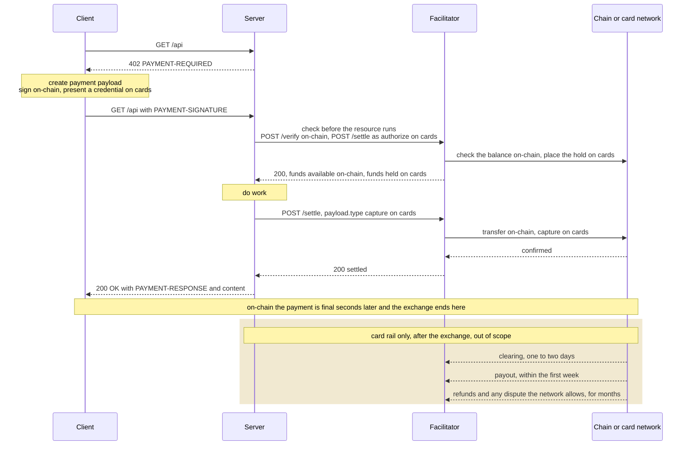
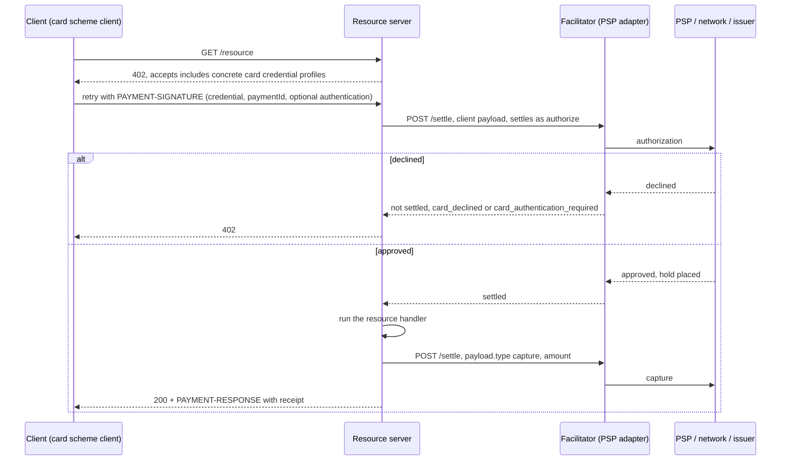

# [DRAFT] Card acceptance on `x402`

- **Status**: Draft
- **Version**: 0.4.0
- **Date**: 2026-08-08
- **Author(s)**: Stefano Amorelli ([@stefanoamorelli](https://github.com/stefanoamorelli))
- **Contributor(s)**: Erik Reppel ([@erikreppel](https://github.com/erikreppel)), Steve Kaliski (Stripe, [@sjkaliski](https://github.com/sjkaliski)), Carson Roscoe (Coinbase, [@CarsonRoscoe](https://github.com/CarsonRoscoe)), Adam Krochak (American Express)
- **Discussion**: `#wg-card-acceptance`

## Open items

| # | Open item | What it is about | Owner | Possible options |
|---|---|---|---|---|
| 1 | What goes in v1 | Whether v1 is only for agents paying for requests, with card checkout for a person in a browser, agent spending permissions, interactive bank verification (3DS), post-payment updates, statement text and refunds handled later as separate proposals (§9). | TBD | (a) agents only, extras later; (b) also support a person paying in a browser; (c) bring one of the other extras back into v1 |
| 3 | How do card networks recognise an agent's x402 payment? | An agent payment fits neither card-network category, cardholder-initiated (CIT) or merchant-initiated (MIT), so the spec has to say what the authorization carries for the network to handle it correctly (§4.4 and §4.7). | TBD | (a) the network agent token carries it; (b) submit it as a payment without the cardholder present (e.g. Stripe `off_session`) and let the PSP set the rest; (c) a dedicated `x402` or agent marker, once a network defines one |

## Motivation

`x402` found its popularity through micro, on-chain transactions, although its potential is much bigger than that. The protocol is payment-method agnostic by construction, and this document proposes cards as its first non-crypto binding.

## Summary

This document defines one thing: a card network binding for the [`auth-capture`](./scheme_auth_capture.md) scheme. The client presents either an encrypted card credential or an opaque reference, the facilitator places an authorization before the resource runs, and the resource server captures or voids it afterwards.

This first version is deliberately small. Delegated authority for agents, micropayments, step-up challenges and post-settlement events are left to follow-up proposals (§9), so that they can be specified once the base binding is agreed.

## 1 Scope

We cover the network identifier, the payment requirements and payload, the settlement contract between client, resource server and facilitator, a high-level client and server integration, decline handling, and security provisions specific to the card rail.

### 1.1 Scope decisions

Card payments involve more steps than the payment exchange, although those processes are not inherently part of the `x402` protocol. `Table 0` states, per topic, what stays out of the scope of `x402` and what this binding takes in scope.

**Table 0. Scope decisions**

| Topic | Out of scope of `x402` | In scope of this binding |
|---|---|---|
| PCI DSS | The compliance assessment of each implementation. | Plaintext card data MUST remain inside the wallet and payment providers. The resource server cannot decrypt card credentials (§8.1). |
| Credential issuance and delegated authority | How a card credential or reference was provisioned, and whether an agent may use it. These are decided by the wallet, provider, card network and issuer. | Credential profile negotiation and presentation (§4.3 and §4.4). |
| Cardholder authentication | Interactive SCA, 3DS and other challenges run by the PSP and issuer. | Pre-completed authentication evidence and a distinct error when more authentication is required (§7.2). |
| Network policy | Pricing, risk checks and dispute rules for `x402` transactions, defined by the card networks. | An `x402` indicator on the authorization, where the PSP exposes one (§4.7). |
| Post-settlement lifecycle | Clearing, payouts, refunds and disputes, which stay with the card networks and the PSP contract. | Nothing. Refunds run through the PSP (§4.6). |
| Merchant onboarding | KYC and the payout schedule, matters of the PSP contract. | Nothing. |

## 2 Glossary

**PSP** payment service provider. The entity that tokenizes card data and executes authorizations, captures and refunds against the card networks (e.g. Stripe, Adyen)

**PAN** primary account number. The card number

**authorization** hold placed on the cardholder's available balance for a stated amount, valid for a limited period

**capture** transfer of previously authorized funds to the merchant

**void** release of an authorization that will not be captured

**minor unit** smallest unit of a currency a card network authorizes in, for example the cent for USD (ISO 4217 exponent)

**3DS** EMV 3-D Secure. The card networks' cardholder authentication protocol, used to satisfy SCA (strong customer authentication) under PSD2

## 3 Payment lifecycle comparison between on-chain and card payments

At payment time the two rails run the same steps. The buyer produces a payment instrument (a signed transfer on-chain, an encrypted credential or reference on cards), the facilitator checks it, the money moves, and the resource is delivered. `Figure 1` traces the exchange both rails share, then the tail that only cards have. An on-chain payment is final a few dozen seconds after settlement. A card payment is not: the funds reach the merchant days later, and refunds and disputes can move them for months afterwards. That tail is outside the scope of `x402` (§1.1).



**Figure 1. The x402 exchange, identical on both rails, and the card-only tail that follows it**

Card payments can be modeled on top of the existing `auth-capture` scheme instead of getting a scheme of their own. `Table 1` maps each on-chain step onto its card equivalent.

**Table 1. On-chain and card equivalents per step**

| Step | On-chain, `exact` | Card, `auth-capture` |
|---|---|---|
| Create the payment instrument | sign the transfer with the wallet | present an encrypted card credential or reference (§4.4) |
| Check before the resource runs | `/verify`, check the signature and the balance | `/settle` as `authorize`, place a hold |
| Move the funds | `/settle`, execute the on-chain transfer | `/settle` with `payload.type` `capture`, collect the held funds |
| Deliver the resource | same on both rails | same on both rails |
| After delivery | final in seconds | funds arrive in days and can keep moving for months, out of scope |

## 4 Scheme binding

### 4.1 General

The card lifecycle (authorize, then capture or void) is the lifecycle of the `auth-capture` scheme. Cards are therefore defined as a network binding for that scheme, in the same way `exact` has EVM bindings. Selection, hooks and receipts keep working as they do for the crypto schemes, and the application code stays unaware of which method paid. `Table 5` in §4.8 maps the network requirements of the parent scheme onto the sections of this binding.

### 4.2 Network identifiers

Network identifiers follow CAIP-2 as `card:<card-network>`, for example `card:visa`, `card:mastercard` and `card:amex`. Interchange, surcharge rules and acceptance differ across card networks, so the reference names the network. A server that accepts several networks lists one `accepts[]` entry per network, and a client can register `card:*` for any of them.

The credential profile is named in `extra.credentialProfile` (§4.3), not in the identifier. Each `accepts[]` entry describes one complete credential route; clients MUST NOT combine fields from different entries.

### 4.3 `PaymentRequirements`

```json
{
  "x402Version": 2,
  "accepts": [
    {
      "scheme": "auth-capture",
      "network": "card:visa",
      "amount": "100",
      "asset": "USD",
      "payTo": "merchant_1Nxyz",
      "maxTimeoutSeconds": 900,
      "extra": {
        "paymentFlow": "escrow",
        "facilitator": "https://pay.example",
        "credentialProfile": "card-cryptogram-v1",
        "credentialProfileDetails": {
          "credentialType": "card",
          "proofType": "cryptogram",
          "recipient": "https://pay.example",
          "encryptionFormat": "jwe",
          "keyId": "key-2026-11",
          "authenticationMethods": ["3ds", "passkey"]
        }
      }
    }
  ]
}
```

- `asset` is an ISO 4217 alphabetic currency code.
- `amount` is the amount to authorize, in minor units of `asset`. It is the ceiling for the capture.
- `payTo` is the merchant identifier understood by the facilitator.

**Table 2. `extra` fields**

| Field | Required | Type | Description |
|---|---|---|---|
| `paymentFlow` | Yes | `"escrow"` | MUST be `"escrow"`. Cards do not offer the `authorization` flow (§4.5) |
| `facilitator` | Yes | `string` | HTTPS origin of the facilitator selected by the resource server |
| `credentialProfile` | Yes | `string` | ID of one credential profile supported by the facilitator |
| `credentialProfileDetails` | Yes | `object` | Definition of the selected profile, copied from the facilitator's advertisement |
| `merchantReference` | for `reference` | `string` | Merchant identifier understood by the reference system |
| `captureDeadline` | No | `number` | Absolute Unix seconds. When absent, the PSP's authorization validity applies |

`credentialProfileDetails.credentialType` is either `card` or `reference`:

- A `card` profile carries `proofType` (`cvv` or `cryptogram`), `recipient`, `encryptionFormat` (`jwe`), `keyId` and, when supported, `authenticationMethods`. `recipient` is the HTTPS origin of the party that decrypts the credential. It MAY be the facilitator or a downstream payment provider; the profile does not expose that provider's role.
- A `reference` profile carries `referenceSystem`, `proofType` and, when supported, `authenticationMethods`. The facilitator is responsible for resolving the reference itself or routing it to a provider that can. Processor selection remains behind the facilitator.

Profile IDs and field values are case-sensitive. A server MUST copy a profile advertised by its facilitator without modification. It emits separate `accepts[]` entries for separate profiles so that every entry is independently usable.

For a `card` profile, the wallet MUST resolve `keyId` from the JWK set at `recipient`'s `/.well-known/x402-card-keys` endpoint over HTTPS. The `402` identifies the recipient and key; it does not carry the public key itself. Key ownership follows from the authenticated origin. Whether the wallet trusts that origin is wallet policy.

The selected JWK MUST have `kty: "RSA"`, `use: "enc"`, `alg: "RSA-OAEP-256"`, a modulus of at least 2048 bits, and a `kid` equal to `keyId`. The wallet MUST reject any other key. The compact JWE MUST use `alg: "RSA-OAEP-256"` and `enc: "A256GCM"` in its protected header and MUST NOT use compression.

Key rotation follows an overlap model:

1. The recipient publishes the new key before the facilitator advertises its `keyId`.
2. The facilitator stops advertising the old `keyId` before the recipient removes it.
3. The recipient keeps the old public and private key available until every credential created while it was advertised has expired.

At payload creation, the wallet MUST set `exp` no later than the current time plus `PaymentRequirements.maxTimeoutSeconds`. A compromised key MAY be withdrawn immediately; the facilitator then rejects affected credentials with `card_credential_key_unavailable`, and the resource server returns fresh requirements using an active key.

### 4.4 Client payload

EXAMPLE Encrypted card credential:

```json
{
  "x402Version": 2,
  "accepted": { "scheme": "auth-capture", "network": "card:visa", "...": "..." },
  "payload": {
    "paymentId": "pay_7d5d747be160e280504c099d984bcfe0",
    "credential": {
      "type": "card",
      "value": "<compact JWE>"
    },
    "authentication": {
      "method": "3ds",
      "evidence": "<opaque authentication artifact>"
    }
  }
}
```

The decrypted JWE plaintext is:

```json
{
  "pan": "<card number>",
  "expiry": "12/29",
  "cryptogram": "<payment cryptogram>",
  "eci": "05",
  "paymentId": "pay_7d5d747be160e280504c099d984bcfe0",
  "requirementsHash": "<base64url SHA-256 digest>",
  "nonce": "n_7af24c819ebb4c18865c6044cc4c800e",
  "exp": 1794873600
}
```

For `proofType: "cvv"`, the plaintext carries `pan`, `expiry` and `cvv`. For `proofType: "cryptogram"`, it carries `pan`, `expiry`, `cryptogram` and `eci`. FPAN, VPAN and DPAN are not separate wire types: the profile describes the fields and proof the recipient can process.

EXAMPLE Opaque reference credential:

```json
{
  "x402Version": 2,
  "accepted": { "scheme": "auth-capture", "network": "card:visa", "...": "..." },
  "payload": {
    "paymentId": "pay_7d5d747be160e280504c099d984bcfe0",
    "credential": {
      "type": "reference",
      "system": "example-vault",
      "value": "ref_1Nxyz",
      "proof": "<provider authorization>"
    },
    "authentication": {
      "method": "passkey",
      "evidence": "<opaque authentication artifact>"
    }
  }
}
```

**Table 3. Client payload fields**

| Field | Required | Description |
|---|---|---|
| `paymentId` | Yes | Client-generated identity of the logical payment, 16 to 128 characters, alphanumeric, hyphens and underscores. Reused unchanged throughout the payment lifecycle |
| `credential` | Yes | Credential matching the selected `credentialProfile` |
| `authentication` | No | Pre-completed authentication evidence matching a method advertised by the selected profile |

The client MUST generate a fresh `paymentId` for each logical payment and preserve it across retries. `paymentId` identifies the payment through its whole lifecycle: the authorization carries it on the client payload, and the resource server copies it into the corresponding `capture` or `void` payload (§4.6).

Where a credential or proof carries `requirementsHash`, it MUST equal `base64url(SHA-256(JCS(accepted)))`, where `accepted` is the selected `PaymentRequirements` canonicalized with RFC 8785 JCS.

For a card credential:

- the wallet, not the agent or resource server, constructs the JWE for the selected profile;
- the JWE protected header MUST contain `alg: "RSA-OAEP-256"`, `enc: "A256GCM"` and a `kid` equal to `keyId`;
- the plaintext MUST carry `requirementsHash`;
- the inner and outer `paymentId` MUST match;
- the recipient MUST reject an expired `exp` or a repeated `nonce`; and
- neither the client nor the resource server may possess the recipient's private key.

For a reference credential, `system` MUST equal the selected profile's `referenceSystem`. The wallet uses `merchantReference` when obtaining the reference. The reference itself MUST be scoped to that merchant and payment, or `proof` MUST verifiably bind `merchantReference`, `paymentId`, `requirementsHash` and an expiry. Placing restrictions next to an unrestricted bearer reference does not bind that reference.

`authentication` carries evidence completed before the paid request, not an interactive challenge. When present, its `method` MUST appear in the selected profile's `authenticationMethods`, and `evidence` MUST be an opaque artifact that the credential recipient can verify against `paymentId` and `requirementsHash`. The client and resource server MUST NOT parse it. An unsupported or invalid artifact is rejected as `card_authentication_required`.

### 4.5 Payment flow and settlement

A card network offers no read-only way to test whether funds are available. The only reliable check is the authorization itself. An authorization commits state at the issuer and holds the cardholder's funds, so it cannot sit behind `/verify`, which is read-only.

Cards therefore bind to the `escrow` payment flow, the default of the parent scheme:

1. The first `/settle` carries the client payload and settles as `authorize`, placing a hold for `amount` before the resource runs.
2. The resource executes.
3. The second `/settle` carries a lifecycle payload with `payload.type` `capture` for the final amount, or `void` when the resource produced nothing to charge for.

`/verify` takes no part in the ordering. The `authorization` flow of the parent scheme, which relies on `/verify` before the resource and a `charge` after it, is not offered on cards, because the pre-resource check it relies on does not exist.

The resource server MAY capture during the request or later from durable state, as the parent scheme allows. Either way:

- the facilitator MUST scope `paymentId` to the authenticated merchant and facilitator, and MUST bind it to the original authorization terms. A retry with the same `paymentId` and the same terms resumes the existing payment intent instead of opening a second hold. Reusing the same `paymentId` with different authorization terms MUST be rejected;
- the facilitator MUST void any authorization it will not capture, and at the latest at `captureDeadline`, since an open authorization blocks the buyer's funds. A hold nobody touches lapses at the issuer when the authorization expires. That lapse is the card equivalent of `reclaim` and needs no action from the client; and
- the capture amount MUST NOT exceed the authorized amount. A capture for less releases the remainder of the hold.

EXAMPLE `SettleResponse` for a successful `authorize`:

```json
{
  "success": true,
  "transaction": "pi_3Nxyz",
  "network": "card:visa",
  "amount": "100"
}
```

`transaction` carries the PSP's charge or intent identifier and `amount` the amount held or captured, in minor units. A PSP that acknowledges a capture without confirming it is reported as `settlement_pending`, with the PSP identifier in `transaction`, as the core specification defines for a broadcast whose confirmation could not be established.

### 4.6 Lifecycle payloads and server consent

`capture` and `void` have no client payload to build on. The resource server authors them and passes them to `POST /settle` with `payload.type` naming the operation, as the parent scheme requires.

EXAMPLE Capture payload for a metered resource:

```json
{
  "x402Version": 2,
  "accepted": { "scheme": "auth-capture", "network": "card:visa", "...": "..." },
  "payload": {
    "type": "capture",
    "paymentId": "pay_7d5d747be160e280504c099d984bcfe0",
    "amount": "73"
  }
}
```

**Table 4. Lifecycle payload fields**

| Field | Required | Description |
|---|---|---|
| `type` | Yes | `capture` or `void` |
| `paymentId` | Yes | the `paymentId` of the authorized payment |
| `amount` | for `capture` | amount to capture in minor units, at most the authorized amount |

The parent scheme requires the binding to authenticate that relayed lifecycle operations are consented to by the resource server. On cards there is no signature to check, so consent is the authenticated identity of the resource server on the settle request, through the credential the facilitator issued it at onboarding. The facilitator MUST refuse a lifecycle payload for a `paymentId` authorized under a different `payTo`.

Each payment accepts one `capture` or one `void`, after which it is closed. A retried lifecycle settle with the same content is answered from the stored outcome instead of being submitted again. One with different content is rejected.

Refunds are not relayed in this version. The resource server issues them through the PSP, against the `transaction` identifier, and funds them from its PSP balance. The facilitator is never a source of refund funds.

### 4.7 Network identification of `x402` transactions

The facilitator SHOULD identify each authorization to the network as an `x402` transaction, so that the network and the issuer can apply the policy and risk checks they define for it. The identifier travels either as a transaction-level indicator in the authorization message or through a merchant configuration reserved for `x402` traffic, whichever the PSP exposes.

### 4.8 Network requirements of the parent scheme

The `auth-capture` scheme lists eight things every network binding MUST specify. `Table 5` gives where this binding does so.

**Table 5. Parent scheme requirements and where the card binding meets them**

| Requirement | Card binding |
|---|---|
| Hold and settlement mechanism | PSP authorization, capture and void against the card network; the capture deadline is `captureDeadline` or the PSP's authorization validity (§4.5) |
| Client authorization format | an encrypted card credential or opaque reference; the payment's identity is `paymentId` (§4.4) |
| Operator model | the facilitator, through its PSP integration, drives every relayed operation; the resource server initiates `capture` and `void`; refunds run out of band at the PSP (§4.6) |
| Server consent | authenticated identity of the resource server on each lifecycle settle (§4.6) |
| Replay protection | credential binding plus one authorization, and then one `capture` or `void`, per authenticated merchant, facilitator and `paymentId` (§4.4 through §4.6) |
| Per-operation verification and settlement | amount ceilings and PSP calls (§4.5 and §4.6), decline classes (§7.3) |
| Refund funding | the merchant's PSP balance, out of band (§4.6) |
| Sync capture-and-void | a single `capture` for the final amount releases the remainder of the hold (§4.5) |

### 4.9 Clarifying idempotency in spec vs extension

`payload.paymentId` is required by this card binding. It identifies one logical payment across authorization, capture or void, and retries.

[`payment-identifier`](../../extensions/payment_identifier.md) is a general, optional extension that resource servers or facilitators MAY support across their payment schemes. Its ID is an idempotency key for one request operation and its retries; it does not follow the payment through its lifecycle. Each lifecycle operation therefore uses a new extension ID while retaining the same `payload.paymentId`.

| Operation | `payload.paymentId` | Extension ID, if included |
| :---- | :---- | :---- |
| Authorize \$1.00 | P | A |
| Retry authorization | P | A |
| Capture \$0.73 | P | B |
| Retry capture | P | B |

*P, A, and B are symbolic identifiers.*

## 5 Client integration

### 5.1 Registration and selection

The application layer is unaffected by the addition of cards. Payment methods are scheme clients registered on the `x402Client`, so the calling code sees the same interface whichever rail ends up paying.

EXAMPLE 1 Registration of the card scheme next to existing crypto schemes:

```ts
const client = x402Client.fromConfig({
  schemes: [
    { network: "eip155:*", client: new ExactEvmScheme(evmSigner) },
    { network: "solana:*", client: new ExactSvmScheme(svmSigner) },
    { network: "card:*",   client: new CardScheme({ vault, ui }) },
  ],
});

const payFetch = wrapFetchWithPayment(fetch, client);

// Application code, identical whether a card or a chain pays:
const res = await payFetch("https://api.example.com/report");
```

Selection between rails is declarative, so by default the client takes the first entry the server offered that it supports. A custom selector, for example, may route small amounts on-chain and larger purchases to the card.

EXAMPLE 2 Amount-based routing between rails:

```ts
paymentRequirementsSelector: (v, reqs) =>
  usdCents(reqs[0]) < 50n
    ? reqs.find(isCrypto) ?? reqs[0]
    : reqs.find(isCard) ?? reqs[0],
```

### 5.2 Scheme client

`CardScheme` implements `SchemeNetworkClient` and registers under `card:*`. It delegates credential creation to a wallet that supports one or more card profiles. A cardholder-present flow may instead collect card data directly in a vault or payment-provider UI and return a reference credential; the agent never receives the card data.

EXAMPLE Core of the scheme client:

```ts
export class CardScheme implements SchemeNetworkClient {
  readonly scheme = "auth-capture";

  constructor(private wallet: CardWallet) {}

  async createPaymentPayload(v: number, req: PaymentRequirements): Promise<PaymentPayloadResult> {
    const paymentId = this.paymentIds.for(req);   // stable across retries of this payment
    const { credential, authentication } = await this.wallet.createCredential({
      profile: req.extra.credentialProfileDetails,
      requirements: req,
      paymentId,
    });
    return this.payloadFrom(v, req, { paymentId, credential, authentication });
  }
}
```

NOTE: `PAYMENT-SIGNATURE` is an HTTP header, and header values reach access logs and proxies. Encrypted credentials and references remain sensitive and MUST NOT be logged (§8.1).

### 5.3 Payment flow



**Figure 2. Card payment flow**

## 6 Server and facilitator

### 6.1 Route configuration

EXAMPLE Mixed route configuration:

```ts
accepts: [
  { scheme: "exact", network: "eip155:8453", payTo: PAY_TO_EVM, price: "$0.97", maxTimeoutSeconds: 60 },
  { scheme: "auth-capture", network: "card:visa", payTo: "merchant_1Nxyz",
    price: "$1.00", maxTimeoutSeconds: 900,
    extra: {
      facilitator: "https://pay.example",
      paymentFlow: "escrow",
      credentialProfile: "card-cryptogram-v1",
      credentialProfileDetails: CARD_CRYPTOGRAM_PROFILE,
    } },
]
```

The server creates one entry per credential profile it and its facilitator support. Configuration order is preserved into `accepts[]`, and the default client selector takes the first supported entry. Surcharging consumer cards can be prohibited depending on jurisdiction.

### 6.2 Facilitator requirements

The complexity of card acceptance is mostly on the facilitator, by design. The client learns to present one advertised credential profile, and the resource server remains unaware of downstream processor routing. Credential resolution, idempotency, decline handling and webhook ingestion are concentrated behind the facilitator.

A facilitator for a `card:<card-network>` network:

- MUST scope `paymentId` to the authenticated merchant and facilitator, bind it to the original authorization terms, and deduplicate authorization retries (§4.5);
- MUST advertise only credential profiles it can process for that merchant and network;
- MUST verify the credential's payment restrictions before authorization (§4.4);
- MUST verify any submitted authentication evidence using the selected profile (§4.4);
- MUST authenticate the resource server on every lifecycle settle and bind lifecycle payloads to the payment's `payTo` (§4.6);
- MUST void any authorization it will not capture (§4.5);
- MUST rate-limit authorizations and collapse hard-decline detail (§8.2); and
- SHOULD identify each authorization to the network as an `x402` transaction (§4.7).

EXAMPLE `/supported` entry:

```json
{
  "x402Version": 2,
  "scheme": "auth-capture",
  "network": "card:visa",
  "capabilities": {
    "credentialProfile": [
      "card-cryptogram-v1",
      "vault-reference-v1"
    ]
  },
  "extra": {
    "facilitator": "https://pay.example",
    "credentialProfiles": {
      "card-cryptogram-v1": {
        "credentialType": "card",
        "proofType": "cryptogram",
        "recipient": "https://pay.example",
        "encryptionFormat": "jwe",
        "keyId": "key-2026-11",
        "authenticationMethods": ["3ds", "passkey"]
      },
      "vault-reference-v1": {
        "credentialType": "reference",
        "referenceSystem": "example-vault",
        "proofType": "provider-authorization",
        "authenticationMethods": ["3ds", "passkey"]
      }
    }
  }
}
```

This binding uses the proposed [`SupportedKind.capabilities`](https://github.com/x402-foundation/x402/pull/2498) field. `capabilities.credentialProfile` is the authoritative list of profile IDs the facilitator supports for this scheme and network. A card facilitator MUST emit it and MUST provide one matching definition in `extra.credentialProfiles` for every listed ID.

The resource server selects an ID from `capabilities.credentialProfile`, copies it into `PaymentRequirements.extra.credentialProfile`, and copies its definition into `extra.credentialProfileDetails`. It MUST NOT select an unadvertised ID or modify the definition.

A `card` profile means the named recipient can decrypt and process that proof type. A `reference` profile means the facilitator has the commercial and technical relationship needed to resolve that reference system. Downstream processors and proprietary resolution APIs are implementation details and are not advertised to the client.

Profiles remain structured and atomic. Independent arrays for `credentialType`, `proofType`, recipient and reference system would imply unsupported Cartesian combinations.

### 6.3 Error codes

In addition to the protocol codes of the core specification, this binding defines:

- **`card_declined`**: the issuer refused the authorization. The facilitator returns this single code for every hard decline (§7.3 and §8.2)
- **`card_authentication_required`**: the issuer requires authentication and the submitted pre-completed evidence was absent or insufficient (§7.2)
- **`card_credential_key_unavailable`**: the selected encryption key was withdrawn before the facilitator could process the credential (§4.3)

## 7 Card-specific considerations

### 7.1 Wallets

The wallet selects a complete credential profile it can satisfy. A wallet may produce an encrypted card credential, a network-token credential using `proofType: "cryptogram"`, or a reference. x402 does not distinguish FPAN, VPAN and DPAN when their wire shape and proof requirements are the same.

Without a wallet, a merchant may present provider-hosted card entry that returns a reference matching an advertised profile. The browser experience and card collection remain outside the protocol; the resulting reference uses the same authorization, capture and void lifecycle.

### 7.2 Cardholder authentication

An issuer may condition an authorization on cardholder authentication. In the EU, PSD2 SCA makes this a common outcome rather than an edge case. A profile MAY advertise authentication methods that the wallet or hosted checkout can complete before submitting the paid request. The resulting opaque evidence is carried in `payload.authentication` and verified by the credential recipient (§4.4).

This version defines no interactive challenge round trip inside the `402` loop. When pre-completed evidence is absent or insufficient, the authorization fails with `card_authentication_required` and no hold is placed. The response does not carry a challenge URL. The client may pick another `accepts[]` entry or obtain new evidence while the cardholder is present.

A challenge round trip over the `402` loop is proposed as a follow-up (§9).

### 7.3 Decline handling and retry limits

Card errors divide into soft declines (retriable with backoff), hard declines (not retriable) and authentication required. Retry limits are card-network rules with fines attached, hence retry classes belong in the binding specification rather than in application code. The facilitator MUST NOT resubmit a hard-declined authorization for the same `paymentId`, and MUST cap soft-decline retries per payment at the lower of the PSP's limit and the network's rule for the transaction type.

## 8 Security considerations

### 8.1 Cardholder data and PCI DSS scope

Plaintext PAN, CVV and track data MUST NOT be exposed to the agent, resource server, prompts, tools, logs or storage. A `card` credential carries that data only inside a JWE encrypted to the selected recipient. The resource server and any relay-only facilitator MUST NOT possess the corresponding private key.

`PAYMENT-SIGNATURE` is an HTTP header and can reach access logs, proxies and monitoring. Encrypted card credentials, references and authentication evidence remain sensitive bearer material and MUST NOT be logged. A recipient that decrypts CVV MUST use it only for authorization and MUST NOT retain it afterwards, including in recoverable ciphertext.

PCI DSS scope follows the implementation and data flow; encryption and outsourcing do not automatically remove a system from scope. `Table 6` states the intended separation, not a compliance determination.

**Table 6. PCI DSS scope per party**

| Party | Card data seen | PCI DSS posture |
|---|---|---|
| Agent and x402 client | encrypted credential or reference only | no plaintext card-data access; implementation must preserve wallet isolation |
| Resource server | encrypted credential or reference only | cannot decrypt; scope depends on implementation and assessor guidance |
| Facilitator | reference, ciphertext, or plaintext when it is the recipient | a decrypting facilitator handles card data and must meet the applicable PCI DSS requirements |
| Wallet, vault or payment provider | card data according to its role | subject to the controls required for the data and keys it handles |

Each party MUST confirm its scope and responsibilities with its assessor and acquiring provider.

### 8.2 Abuse resistance

For on-chain transactions the `/verify` check costs nothing, but with cards the check before the resource runs reaches a real issuer, holds the buyer's funds and counts against the merchant's fraud ratios. The facilitator MUST rate-limit authorizations by credential fingerprint and IP, MUST collapse hard-decline detail into `card_declined`, and MUST NOT authorize a single-use credential more than once.

The wallet MUST verify that a card credential's key belongs to the selected recipient origin before releasing it. After decryption, the recipient MUST validate `requirementsHash`, `paymentId`, `nonce` and `exp` before using the credential for authorization. A resource server cannot make its own key trustworthy merely by placing it in a `402`.

## 9 Follow-up proposals

The following were drafted in earlier revisions of this document and are left out of this version. Each can be proposed separately on top of the base binding, as an extension or as an additional binding.

- **Credential provenance and delegated authority.** Telling the PSP, the network and the issuer where the token comes from (single-use, card on file, agentic token), who initiated the payment, and a reference to the cardholder's mandate when they require one.
- **Micropayments.** A card binding of `batch-settlement`, with a facilitator ledger that accumulates charges below one minor unit and captures whole minor units per billing cycle.
- **`step-up-challenge`.** A corrective `402` carrying the issuer's challenge, and a retry that resumes the same payment.
- **`payment-events`.** A facilitator-to-resource-server channel for the card tail of `Figure 1`: payouts, refunds and dispute outcomes.
- **Statement descriptor and line items.** A merchant-chosen dynamic descriptor and Level 2/3 consumption data on the capture.
- **Relayed refunds and multiple captures.** `refund` as a relayed lifecycle payload, and more than one `capture` per authorization where the network allows it.

## Version History

| Version | Date | Changes | Authors |
|---|---|---|---|
| 0.4.0 | 2026-11-17 | Replaced the PSP-token-only payload with negotiated encrypted-card and reference credential profiles; added recipient-origin key discovery and rotation, payment and merchant binding, pre-completed authentication evidence, and per-kind facilitator capabilities | @SteveReis, @SuryaNaragani, @stefanoamorelli, @CarsonRoscoe |
| 0.3.0 | 2026-11-16 | Hardened and clarified idempotency without changing the binding: distinguished lifecycle-wide `payload.paymentId` from the per-operation `payment-identifier` extension and scoped replay protection to the authenticated merchant and PSP | @CarsonRoscoe |
| 0.2.0 | 2026-10-06 | Reduced to the base binding. `network` stays CAIP-2 with the PSP in `extra.psp`; the payload is the token and a `paymentId`; refunds run at the PSP. Provenance, micropayments, step-up and payment events move to follow-ups (§9) | @stefanoamorelli |
| 0.1.0 | 2026-08-08 | Initial draft | @stefanoamorelli |
