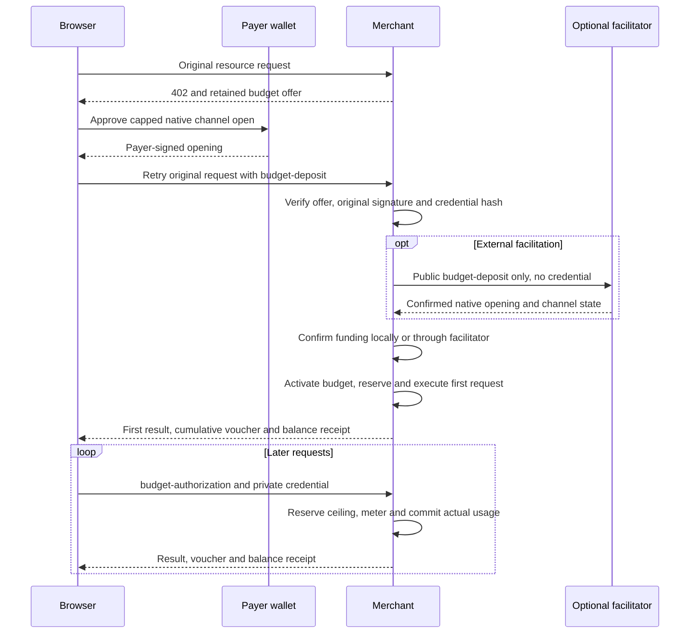
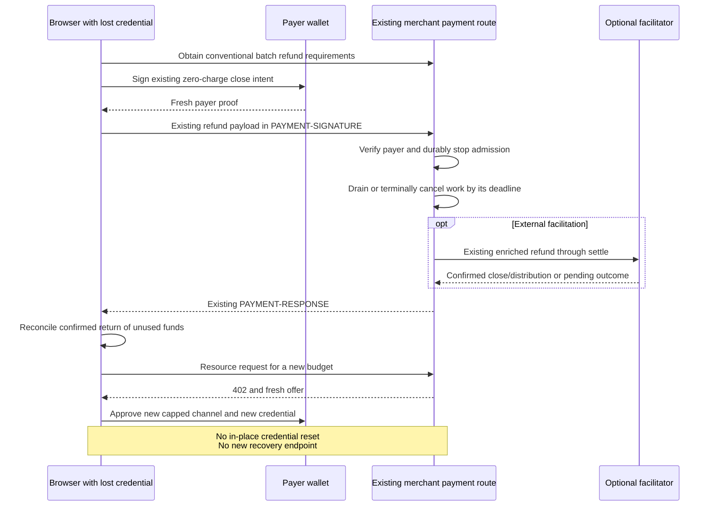

# Proposal: SVM conversation-budget authorization v1

## Summary

A browser user approves a spending budget once, such as $5 USDC for a chat.
A dedicated payment channel holds that amount. Later requests use a private
conversation credential, and the merchant records actual usage and signs the
existing cumulative vouchers. If the credential is lost, the user authorizes
the existing refund flow with their payer wallet, then approves a new channel.

**Status: draft for protocol review, not an implemented or deployed feature.**
This proposal extends the [SVM batch-settlement binding](scheme_batch_settlement_svm.md).
It specifies authorization and close-and-reopen recovery together. Credential
replacement, credential generations and recovery-specific endpoints are outside
v1. No change to the payment-channel program or voucher encoding is proposed.

The key words MUST, MUST NOT, SHOULD and MAY indicate requirements as defined
by [BCP 14](https://www.rfc-editor.org/rfc/rfc8174). This supplement defines the
selected mode's message formats, validation and observable behavior. Storage,
locking, SDK APIs and framework configuration are implementation choices.
The parent binding applies except for the explicit mode-specific flow,
client/facilitator payload variants, payer proof, Memo and retry rules below.
Core message types and the
[HTTP transport](../../transports-v2/http.md) are reused without new headers.

## 1. Scope and negotiation

The scheme remains `batch-settlement`, using x402 v2 and the existing HTTP
`PAYMENT-REQUIRED`, `PAYMENT-SIGNATURE` and `PAYMENT-RESPONSE` headers. This is a
scheme-specific authorization mode, not a new generic `extensions` registration.
Unselected legacy client/server-signed behavior remains unchanged.

Proposed capability and requirement fields:

| Location | Field | Meaning |
| --- | --- | --- |
| Facilitator `/supported` extra | `authorizationModes` | Includes `"conversation-budget-v1"` only when its budget-opening path is supported. |
| Merchant payment requirements extra | `authorizationMode` | Exactly `"conversation-budget-v1"` selects this proposal. Absence selects existing behavior. |
| Same requirements extra | `voucherSigner`, `operator` | MUST select `"server"` and identify the trusted operator, as in existing server mode. |
| Same requirements extra | `paymentFlow` | MUST be `"escrow"` for budget-funded resource requests. |
| Merchant 402 `accepts[i].extra` | `budgetOffer` | A retained, single-use offer as defined below; not authority merely because a client echoes it. |

`authorizationModes` is a JSON array of case-sensitive strings. Absence or
omission of this mode means unsupported. A malformed capability value MUST NOT
be used to advertise budget mode.

All three roles MUST support the selected mode. A client considering a list of
accepts MUST skip modes it does not support without invalidating other supported
accepts. It MUST NOT reinterpret an unknown mode as legacy authorization.
Selecting an unsupported mode or a mismatched signer/flow combination MUST fail
closed. A client MUST NOT silently downgrade a failed budget request to another
authorization.
Existing operator-trust and local spending-limit checks still apply. Selecting
the escrow flow is explicit user/client policy; the general preference for
post-handler authorization does not constitute consent to a conversation budget.

The merchant MUST also advertise a conventional server-signed batch accept on
the same protected route for `refund`, with the same network, asset, receiver,
operator, sponsor, receiver authorizer and withdrawal delay. That accept omits
`authorizationMode` and uses the existing `authorization` flow. Refund clients
MUST select that advertised accept rather than reusing the budget escrow accept.
Selection MUST match the channel's original network, asset, receiver, operator,
sponsor, receiver authorizer and withdrawal delay, with `authorizationMode`
absent and `paymentFlow` absent or `"authorization"`. Accept order MUST NOT
affect this selection. This keeps refunds in the existing
verify/skip-handler/settle control path.

For a budget-tagged channel, the conventional accept permits only `refund`.
The merchant MUST reject legacy `deposit`, `voucher` and `authorization`
payloads for that channel with `invalid_batch_settlement_svm_budget_mode`.
In particular, a legacy top-up MUST NOT increase its approved escrow.

For example, the decoded `PAYMENT-REQUIRED` object advertises both accepts:

```json
{
  "x402Version": 2,
  "resource": { "url": "https://merchant.example/chat", "mimeType": "application/json" },
  "accepts": [
    {
      "scheme": "batch-settlement",
      "network": "solana:EtWTRABZaYq6iMfeYKouRu166VU2xqa1",
      "asset": "<base58 mint>",
      "payTo": "<base58 merchant receiver>",
      "amount": "1000000",
      "maxTimeoutSeconds": 60,
      "extra": {
        "authorizationMode": "conversation-budget-v1",
        "paymentFlow": "escrow",
        "voucherSigner": "server",
        "operator": "<base58 operator>",
        "feePayer": "<base58 sponsor>",
        "receiverAuthorizer": "<base58 receiver authorizer>",
        "withdrawDelay": 900,
        "tokenProgram": "TokenkegQfeZyiNwAJbNbGKPFXCWuBvf9Ss623VQ5DA",
        "budgetOffer": {
          "version": 1,
          "id": "0123456789abcdef0123456789abcdef",
          "audience": "https://merchant.example",
          "maximumAmount": "5000000",
          "expiresAt": 1800000600
        }
      }
    },
    {
      "scheme": "batch-settlement",
      "network": "solana:EtWTRABZaYq6iMfeYKouRu166VU2xqa1",
      "asset": "<base58 mint>",
      "payTo": "<base58 merchant receiver>",
      "amount": "1000000",
      "maxTimeoutSeconds": 60,
      "extra": {
        "paymentFlow": "authorization",
        "voucherSigner": "server",
        "operator": "<base58 operator>",
        "feePayer": "<base58 sponsor>",
        "receiverAuthorizer": "<base58 receiver authorizer>",
        "withdrawDelay": 900,
        "tokenProgram": "TokenkegQfeZyiNwAJbNbGKPFXCWuBvf9Ss623VQ5DA"
      }
    }
  ]
}
```

Clients communicate with the merchant. Capability discovery, funding, claims
and refunds are performed by the merchant or its configured facilitator. A
self-facilitating merchant exposes the same client interface. No facilitator
URL, direct facilitator call or separate budget-setup endpoint is required.
Existing trusted RPC and mint-owner validation requirements are unchanged.
Absence of the facilitator capability means this mode is unsupported; the
merchant MUST NOT advertise it in that configuration.

## 2. One channel, one approved budget

V1 requires a fresh, otherwise-unused channel whose deposit equals the approved
maximum. An existing larger channel cannot be treated as an equally protected
smaller budget. Top-ups, extension of expiry, multi-merchant budgets and in-place
credential replacement are outside this version.

The merchant retains an offer before wallet approval:

| `budgetOffer` field | Rule |
| --- | --- |
| `version` | Exactly `1`. |
| `id` | Merchant-generated unpredictable 16 bytes, encoded as 32 lowercase hex characters. Single use across its funding attempts/channels. |
| `audience` | Canonical HTTPS merchant origin, without a path, credentials or fragment. |
| `maximumAmount` | Positive canonical decimal u64 atomic amount, at least the first request's quoted ceiling. |
| `expiresAt` | Positive safe-integer Unix seconds, within the merchant's configured budget lifetime. |

The audience uses origin determination and ASCII serialization from
[RFC 6454 sections 4 and 6.2](https://www.rfc-editor.org/rfc/rfc6454#section-6.2):
lowercase HTTPS scheme/host, ASCII IDNA A-labels, default port `443` omitted and
no trailing slash. Opaque origins are rejected. Comparison is exact after this
serialization; no domain-suffix or Unicode-display comparison is permitted.

The offer is also bound to the route's network, asset, receiver, operator,
sponsor, receiver authorizer and withdrawal delay. The merchant MUST retain
these bindings and the application/request context; it MUST NOT adopt a
client-supplied offer after state loss. A route may attach a new offer to its
402 response while retaining previous offers for their pending attempts.

`budgetOffer` is dynamic metadata: matching an accept MUST exclude that entire
field from comparison with a newly generated advertisement. All other static
requirements remain binding. For `budget-deposit`, the merchant MUST instead
look up the original offer by `budget.id` and require every echoed offer field
to equal its retained value. For `budget-authorization`, a newly advertised or
echoed offer MUST NOT replace the active grant. The client MAY omit
`accepted.extra.budgetOffer` on later requests. Excluding a field from accept
matching never makes it client authority.

The initial ordinary resource request need not already identify a payer or
credential hash. The browser adds those client-controlled fields when building
the payer-signed open. They are accepted only under the retained offer and the
native transaction's exact signature and bindings. Implementations MAY use
application hints to choose a quoted budget; hints are not authorization.

The client generates an unpredictable 32-byte private credential, encoded as
exactly 64 lowercase hex characters, fresh for each budget. `credentialHash` is
lowercase hex SHA-256 of the ASCII credential string. Only the hash is public.
The merchant stores the hash and grant; it MUST NOT persist the raw credential.

Before approving a budget opening or disclosing its credential, the client MUST
require `budgetOffer.audience` to equal the canonical HTTPS origin of the resource URL
it intended to request. The URL is client-trusted input; echoed `resource.url`
metadata does not establish that origin. The client MUST send credential-bearing
payloads only to that origin and MUST NOT forward them across an origin-changing
redirect. The merchant independently checks the audience against its trusted
configuration. An origin mismatch fails before signing or funding.

Before approval, the user MUST see the funding amount/asset, expiry, merchant,
operator trust and how to stop/refund. Budget expiry is distinct from the HTTP
`maxTimeoutSeconds`. Both expiry and Stop are merchant admission policy, not
revocation of the operator's existing onchain authority over the deposit.

`expiresAt` bounds admission; it does not guarantee that a native channel stays
open until then. An idle close can end a zero-spend channel earlier. The idle
gap is measured since the last facilitator-visible `deposit`/`budget-deposit`,
`claim` or `settle` activity under the parent binding; merchant resource requests do not
reset it. If that gap reaches `maxIdleSecs`, or its last activity time is unknown,
the merchant MUST obtain a fresh trusted channel read before admitting work.
An observed non-open channel cannot
be made spendable by a still-unexpired budget.

## 3. Opening commitment and payload

### 3.1. Field syntax

Core JSON objects use the existing x402 encoding. No canonical JSON property
order is required; hashes commit the explicit text encoding in section 3.2.

| Field | JSON type and validation |
| --- | --- |
| `budgetOffer` | Object with exactly the five fields defined in section 2. |
| `budget` | Those same five offer fields plus `credentialHash`; unknown fields are rejected in v1. |
| `budgetId` | String equal to the retained offer/grant ID. |
| `credential`, `credentialHash` | Strings with the syntax below; the hash commits the ASCII credential string. |
| `requestId` | Nonempty string of 1–256 UTF-8 bytes, binding one logical resource operation. |
| `channelConfig` | The existing `ChannelConfig`, with `voucherSigner: "server"`; satisfy the opening bindings initially and match the activated grant on later operations. |
| `deposit.amount` | Positive decimal u64 string equal to the approved `maximumAmount`. |
| `deposit.transaction` | Existing Base64 native-transaction encoding, validated under section 3.2. |

The following ABNF uses `DIGIT`, `ALPHA` and `LF` from
[RFC 5234](https://www.rfc-editor.org/rfc/rfc5234) and case-sensitive strings from
[RFC 7405](https://www.rfc-editor.org/rfc/rfc7405):

```abnf
lower-hex      = DIGIT / %x61-66
budget-id      = 32lower-hex
credential     = 64lower-hex
sha256-hex     = 64lower-hex
nonzero-digit  = %x31-39
uint           = "0" / (nonzero-digit *DIGIT)
positive-uint  = nonzero-digit *DIGIT
base64url-char = ALPHA / DIGIT / "-" / "_"
terms-hash     = 43base64url-char
budget-memo    = %s"x402-batch-budget-v1" LF
                 %s"Budget: " budget-id LF
                 %s"Cap: " positive-uint LF
                 %s"Expires: " positive-uint LF
                 %s"Terms: " terms-hash
```

These rules apply to decoded strings and Memo bytes, not JSON string quoting or
HTTP field-line syntax. Numeric range checks still apply: the cap fits u64 and
expiry fits a positive safe integer. `terms-hash` MUST be the canonical unpadded
base64url encoding of the reconstructed 32-byte digest; syntax alone is not
verification. The Memo has no final LF and rejects CRLF, case changes, extra
whitespace or additional lines.

### 3.2. Native opening commitment

Use the existing canonical open instruction, recipient distribution and
receiver-authorizer binding Memo. The opening's `payerAuthorizer` is the
advertised operator and `voucherSigner` is `"server"`. Preserve existing
signer/account/instruction allowlists, mint owner, transaction-version, slot,
compute/fee and sponsor checks. The program ID remains the network constant.

The budget opening uses the seller-reference Memo slot for the canonical Memo
below; it MUST NOT append an additional instruction outside the existing
allowlist. If a seller reference is required, its exact UTF-8 value is committed
inside the terms digest. A client MUST NOT append or substitute a second seller
Memo. The separate receiver-authorizer binding Memo remains unchanged.

Full terms are encoded as these exact ASCII lines, in this order, with LF
separators and no trailing newline:

```text
x402-batch-budget-terms-v1
Budget ID: <offer.id>
Network: <accepted.network>
Audience: <offer.audience>
Payer: <channelConfig.payer>
Operator: <accepted.extra.operator>
Receiver: <channelConfig.receiver>
Receiver authorizer: <channelConfig.receiverAuthorizer>
Sponsor: <accepted.extra.feePayer>
Asset: <channelConfig.token>
Token program: <accepted.extra.tokenProgram>
Maximum amount (atomic units): <offer.maximumAmount>
Expires at (Unix seconds): <offer.expiresAt>
Credential SHA-256: <credentialHash>
Salt: <channelConfig.salt>
Open slot: <channelConfig.openSlot>
Withdrawal delay (seconds): <channelConfig.withdrawDelay>
Seller memo SHA-256: <sellerMemoHash>
```

Addresses MUST decode to 32 bytes; numbers use canonical unsigned decimal with
no sign or leading zeroes except `0` where the existing field allows it.
`expiresAt` is positive; `openSlot` fits the client's safe integer range. The
audience MUST be its ASCII serialized HTTPS origin and match trusted merchant
configuration, not a request's untrusted Host header. The hash fields have
exactly 64 lowercase hex characters. Unknown or additional terms are rejected;
no trimming or Unicode/line-ending normalization is allowed.

`sellerMemoHash` is lowercase hex SHA-256 of UTF-8 `accepted.extra.memo`, treating
absence as the empty string. The digest is always 64 hex characters; for absence
or an empty reference it is exactly
`e3b0c44298fc1c149afbf4c8996fb92427ae41e4649b934ca495991b7852b855`.

Let `termsHash` be unpadded base64url of SHA-256 of those bytes. The actual Memo
is compact, ASCII, LF-separated and has no trailing newline:

```text
x402-batch-budget-v1
Budget: <offer.id>
Cap: <offer.maximumAmount>
Expires: <offer.expiresAt>
Terms: <termsHash>
```

It MUST fit the existing 256-byte Memo limit. The full terms digest binds the
credential, audience, network and native channel configuration without putting
the secret onchain. Native instructions independently bind the actual escrow,
operator and receiver. Clients and facilitators reconstruct both encodings;
wallet-returned display text is not a substitute for verified original bytes.

For `budget-deposit`, the facilitator MUST require this exact reconstructed
Memo in the seller-reference slot and require
`open.deposit == deposit.amount == budget.maximumAmount`. It MUST reject a
`top_up` instruction. This mode replaces only the parent binding's seller-Memo
`extra.memo`/hex-nonce data rule; the instruction count/order, receiver-binding
Memo and all other native allowlists remain unchanged. An `extra.memo` value
is committed through `sellerMemoHash`, not emitted as a second seller Memo.

### 3.3. Payload variants

| `payload.type` | Required fields and recipient |
| --- | --- |
| `"budget-deposit"` | Browser to merchant: `channelConfig`, `budget`, `requestId`, `credential`, and `deposit` with `amount` and `transaction`. Merchant to facilitator: the validated public variant with `credential` absent. |
| `"budget-authorization"` | Browser to merchant only: `channelConfig`, `budgetId`, `requestId`, `credential`. No transaction or synthesized per-request payer proof. |
| `"refund"` | Existing parent payload and payer proof, under the conventional authorization accept; section 5 applies. |

The browser retries the original request with this new payload variant in
`PAYMENT-SIGNATURE`; its `accepted` is the selected budget accept:

```json
{
  "type": "budget-deposit",
  "channelConfig": {
    "payer": "<base58 payer>",
    "payerAuthorizer": "<base58 operator>",
    "receiver": "<base58 merchant receiver>",
    "receiverAuthorizer": "<base58 receiver authorizer>",
    "token": "<base58 mint>",
    "withdrawDelay": 900,
    "salt": "42",
    "openSlot": 341000000,
    "voucherSigner": "server"
  },
  "budget": {
    "version": 1,
    "id": "<retained offer ID>",
    "audience": "https://merchant.example",
    "maximumAmount": "5000000",
    "expiresAt": 1800000600,
    "credentialHash": "<64 lowercase hex characters>"
  },
  "requestId": "<fresh operation ID>",
  "credential": "<private 64-character hex credential>",
  "deposit": {
    "amount": "5000000",
    "transaction": "<base64 payer-signed open>"
  }
}
```

The address placeholders stand for the existing validated 32-byte Base58 keys.
No legacy single-request payer proof is synthesized. `deposit.amount` MUST equal `budget.maximumAmount`; the first
request's charge ceiling is still `accepted.amount`, not the full deposit.

## 4. First request and repeated requests

The successful first resource uses one ordinary 402 challenge and one signed
retry. A fresh opening and credential approval are carried by the same native
transaction; no additional message signature or registration round trip is
required. Wallet transaction previews and popup counts require validation.



The merchant MUST validate the retained offer, payer signature, exact Memo,
credential hash and request context before submitting funding. It atomically
binds the offer to one channel, one transaction-message fingerprint and the
first resource operation's ID/fingerprint before broadcast; duplicate
submissions reconcile that attempt. A different payer, channel, message or
first operation cannot race an in-flight attempt into a second active grant.
Unsigned preparation or a valid payer signature is not proof of funding.

Once an offer is bound to a valid funding attempt, it MUST NOT be rebound,
including after a definitive failure before broadcast. A rebuilt transaction
requires a fresh offer and explicit approval. The old attempt MUST be reconciled
before it is treated as unfunded; response loss or an RPC timeout is not proof
of failure. Unresolved funding cannot trigger automatic replacement funding.

Budget resource requirements explicitly select the existing core `escrow`
ordering: before-handler funding/reservation, resource, after-handler actual
commitment, response. Legacy batch requirements keep their `authorization`
ordering. `/verify` remains read-only and MUST NOT broadcast an open.

For a new channel, the merchant's before-handler settle submits only the public
budget/deposit/configuration to the configured facilitator, or self-facilitates.
The private credential MUST be removed before forwarding and MUST NOT reach
facilitator logs, traces or transaction metadata. The facilitator's
`budget-deposit` input contains the public fields above but no `credential`;
the merchant constructs it from a validated public-field allowlist rather than
forwarding the original header object or request body.
The forwarded `paymentRequirements` MUST be the merchant-retained accept bound
to `budget.id`, including its original `budgetOffer`. The merchant MUST set the
sanitized `paymentPayload.accepted` to that same retained accept. It MUST NOT
substitute newly generated requirements or forward unvalidated client extras.
The facilitator validates the digest/native envelope, sponsors and confirms the open.
The signed Memo commits the public hash, so the facilitator need not know its
preimage. Only this funding variant is a facilitator budget-operation input.

After trusted confirmation, the merchant verifies the actual channel, successful
transaction, inclusion slot, sponsor signature, deposit equality, settled zero,
roles and retained bindings, then activates and reserves the first request.
Expired or explicitly stopped funding attempts MUST NOT activate spending. A
late confirmed open still needs a retained, wallet-refundable channel record;
do not discard funds or report that no deposit exists merely because admission
was canceled. Retain
zero spending/reservations and the correct funded deposit for such an unused
channel; refund preparation uses the existing zero-cumulative operator-voucher
case, not a fabricated charge. No operator voucher advances an equal onchain
watermark unnecessarily.

The first request's after-handler settle is merchant-local too: it commits the
actual charge and ordinary cumulative operator voucher, rather than posting a
second opening or forwarding the private credential to the facilitator.

Later requests carry:

```json
{
  "type": "budget-authorization",
  "channelConfig": {
    "payer": "<base58 payer>",
    "payerAuthorizer": "<base58 operator>",
    "receiver": "<base58 merchant receiver>",
    "receiverAuthorizer": "<base58 receiver authorizer>",
    "token": "<base58 mint>",
    "withdrawDelay": 900,
    "salt": "42",
    "openSlot": 341000000,
    "voucherSigner": "server"
  },
  "budgetId": "<original offer ID>",
  "requestId": "<fresh operation ID>",
  "credential": "<private 64-character hex credential>"
}
```

For each later operation, the merchant MUST look up the retained grant by
`budgetId`, compare the supplied credential's hash in constant time, derive the
channel ID from `channelConfig` and require equality with the grant's bound
channel ID and all immutable configuration fields. These checks and admission
against that grant MUST form one accounting decision. A credential for another
budget cannot authorize a different channel, including one with identical
operator/receiver settings. Failure rejects the request without work or funding.

The merchant also verifies current route requirements.
`accepted.amount` is the quoted per-request ceiling. Echoed offers/extra fields
MUST NOT redefine grant authority; current route pricing and the retained grant
must both be satisfied. A client obtains fresh requirements if pricing changed.

For an already-funded channel, the before-handler and after-handler settles
are durable merchant-ledger operations: reserve the ceiling, then commit the
actual charge and ordinary operator voucher. They do not require forwarding
the credential or an HTTP `/settle` call to an external facilitator. Periodic
redemption continues using the existing server-authenticated claim/voucher path.
The facilitator MUST NOT accept `budget-authorization` as a direct payer proof.

The merchant MUST authenticate and reserve atomically, requiring:

```text
spent + reserved + next request ceiling <= approved maximum
```

Each request ID binds the channel, request fingerprint, quote, reservation and
terminal outcome. Conflicting reuse MUST fail. Identical retries MUST NOT repeat
work or charges. Their payment receipts use `PAYMENT-RESPONSE`. An unresolved
operation returns `duplicate_settlement` or
`settlement_pending` with its known reconciliation facts; a completed operation
returns its retained payment receipt. A terminally canceled operation returns
`success: false`, `errorReason: "invalid_batch_settlement_svm_budget_operation_canceled"` and current
`extra.budget`. It MUST NOT be reported as still pending. This resolves the
logical operation; it does not authorize automatic re-execution of the original
application action under a fresh payment ID. A stored application result requires
application-level
idempotency as well; a payment receipt alone cannot recreate an AI response.

V1 clients MUST keep at most one logical paid operation in flight per channel,
including the first funded resource. They MUST reuse its request ID and original
request/quote when retrying an ambiguous outcome, and MUST NOT start a new
operation until it is resolved. This is the mode-specific exception to the
parent's fresh-ID-per-transport-retry rule. A retry is evaluated against its
retained original quote and outcome, not re-executed at a new price. New logical
operations use fresh IDs and current quotes. Merchants MUST still prevent
overspending or duplicate work under concurrent inputs.

After metering, commit actual cost `0 <= actual <= reserved ceiling`, the request
outcome, cumulative amount and unchanged operator voucher atomically. Signing
and persistence MUST NOT allow a stale completion to overwrite another charge
or a cancellation. Release unused reserved capacity in the same commit. Failed/timed-out work does
not by itself establish a terminal outcome. Preserve ambiguous reservations
until reconciled or terminally canceled under the deadline below. A confirmed
failed or canceled resource follows the existing no-charge policy: release its
reservation without advancing the voucher. Costs incurred by an external
provider do not alone authorize charging a failed
resource request. A lost HTTP response is not proof that the handler failed.

Every reservation has a deadline equal to its merchant-recorded admission time
plus the quoted `maxTimeoutSeconds`; retries MUST NOT extend it. The merchant
MUST reconcile by that deadline: commit a durably established successful charge,
or durably cancel the payment operation without charge and release capacity.
Cancellation MUST permanently prevent every late worker/result for that operation
from committing a charge or voucher. Time passage alone MUST NOT release a
reservation or allow its operation to run again. Following downtime, the merchant
MUST finalize overdue reservations before admitting new work or completing a
refund. External work may continue, but cannot resurrect a canceled payment.
Merchants SHOULD choose a handler timeout that leaves enough time to commit
before the advertised deadline; execution finishing at the deadline does not
create a right to charge afterward.

Funding remains durable if the first handler fails after the opening confirms.
Preserve its channel/grant and expose or reconcile the funding transaction and
budget identity on the error path. Do not fund another channel merely because
the resource result failed or was lost; existing refund access remains available.
Canceling that resource operation MUST NOT cancel its confirmed funding, close
the channel, or stop an otherwise-active grant. After releasing its reservation
without charge, the grant remains active if it is unexpired, unstopped and its
native channel is usable. This differs from an explicit stop of a funding
attempt before activation; resource-handler cancellation is not that action.

`PAYMENT-RESPONSE` retains the existing commitment/actual-charge/voucher fields
and adds proposed `extra.budget` with `id`, `maximumAmount`, `expiresAt`, `spent`,
`reserved`, `available` and admission `status`. Amounts are canonical atomic
strings, and `available = maximumAmount - spent - reserved`. The response MUST
distinguish merchant acceptance from later onchain redemption. The client
verifies operator vouchers and never treats the full deposit as the first charge.
For a successful resource receipt, `budget.spent` MUST equal the authenticated
voucher's cumulative amount; the ordinary per-request charge/watermark checks
still apply. A retry receipt cannot move the client's confirmed watermark
backwards or count a previously accepted charge again.

Admission `status` is one of `"funding-pending"`, `"active"`, `"stopped"`,
`"expired"`, `"closing"`, or `"closed"`. These are merchant lifecycle states,
separate from the native channel status. `active` requires confirmed funding,
an unexpired, unstopped grant and a usable native channel. `closing` means the
merchant has stopped admission to reconcile/close, not necessarily that an
onchain `request_close` has landed. `closed` requires confirmed finalization.
No pending/expired/stopped/closing state authorizes new paid work.

## 5. Recovery uses the existing refund flow

There is no new `/recover`, `/reset`, challenge or credential-replacement
endpoint in v1. The client calls the merchant's existing batch payment/refund
route with the existing `type: "refund"` payload in `PAYMENT-SIGNATURE`.
It selects the advertised conventional server-signed `authorization` accept,
not the budget `escrow` accept, using section 1's order-independent matching.
The merchant MUST dispatch authenticated refund control messages at that
resource URL independently of the paid handler and its method restrictions.
Transport mapping is otherwise unchanged; no recovery-specific route is added.

### 5.1. Stop authority

In v1, the user's Stop action is the existing payer-authenticated refund intent.
It stops new admission immediately and proceeds to close after pending work is
resolved. The merchant MAY administratively stop a grant, including an opening
not yet activated; it MUST retain wallet-authenticated refund access. The
conversation credential alone MUST NOT stop or reactivate a grant. Stop is
irreversible for that grant, including after a failed close attempt. Further
spending requires a new, explicitly approved channel; existing funding follows
the confirmed refund/reopen sequence below.

### 5.2. Refund processing

The normal server-mode refund remains:

1. The **actual payer wallet** signs a fresh existing `BatchAuthorization` with
   `authorizedAmount: "0"`, a fresh request ID and normal proof expiry.
   The private conversation credential MUST NOT be required, even if lost,
   the budget expired or the merchant previously stopped it. Zero is close
   intent, not the amount returned. The channel still has to be identified.
2. The merchant verifies that proof against the immutable channel payer and
   existing operator/receiver bindings. An already-closed grant returns its
   terminal receipt below and MUST NOT regress to `closing`. Otherwise, the
   merchant MUST durably set admission to `closing` before checking for pending
   reservations or returning busy/pending.
   A racing request is either reserved before that stop or rejected afterward;
   successful verification alone cannot leave admission open. Busy/pending
   responses MUST preserve the stop. The paid handler is bypassed. Previously
   admitted work finishes or is terminally canceled under section 4's deadline
   before the final accepted voucher is used. An unauthenticated probe MUST NOT
   stop a budget.
   The accepted close intent and its authenticated channel/payer bindings MUST
   be retained with the stop. Proof expiry is checked at initial acceptance;
   later expiry MUST NOT revoke that accepted, irreversible close intent.
   A newly submitted payer proof still requires normal expiry validation; this
   rule authorizes continuation of the retained close, not new expired proofs.
3. The merchant injects its stored final operator voucher and existing
   receiver-authorizer `CloseAuthorization`; it does not trust a payer-supplied
   voucher in server mode. It submits the existing enriched `refund` to its
   facilitator's `/settle`, or performs the same work locally.
   Once reservations resolve, the merchant MUST automatically attempt and
   reconcile this close under the existing retry rules, without requiring another
   payer proof or client request. Any newly generated
   receiver `CloseAuthorization` still obeys its own validity window. A fresh
   proof on a client status retry authenticates the retry; it is not needed to
   keep the already-authorized close progressing.
4. The existing cooperative `settle_and_seal` plus sealed `distribute` pays the
   final accepted charges and returns the remaining escrow to the payer. Keep
   the existing receiver-binding, delegated-authorizer, simulation and retry rules.
5. A pending/ambiguous response is reconciled by transaction and channel state;
   only confirmed distribution establishes the refund. Repeat requests MUST NOT
   duplicate close, payout, or paid work. Retain the terminal channel record.

A later refund retry with a fresh valid payer proof MUST work against a
`closing` or `closed` grant without the bearer or a still-open native account.
The merchant verifies the proof against retained original payer/channel bindings
before returning status; it MUST NOT reject solely because the native channel
has already closed. It reconciles any existing attempt rather than creating a
second close. `PAYMENT-RESPONSE` uses the existing settlement fields:

| Outcome | Required receipt |
| --- | --- |
| Admission stopped, reservations remain and nothing was broadcast | `success: false`, `errorReason: "duplicate_settlement"`, empty `transaction` and `amount`, `extra.budget.status: "closing"`. |
| Close broadcast, confirmation unresolved | `success: false`, `errorReason: "settlement_pending"`, `transaction` contains the broadcast signature, empty `amount`, `extra.budget.status: "closing"`. |
| Confirmed `request_close`, grace/distribution still pending | Existing initiation receipt: its confirmed transaction signature, empty `amount`, `extra.budget.status: "closing"`. |
| Confirmed final distribution | Retained terminal receipt: `transaction` identifies the confirmed distribution (the cooperative close transaction when combined), `amount` is confirmed unused escrow returned, and `extra.budget.status` is `"closed"`. |

These receipts retain the channel snapshot and applicable budget accounting.
A known close/distribution broadcast signature MUST survive every pending/error
response and be reconciled before rebroadcast; it MUST NOT be replaced with an
empty transaction.
A terminal retry returns the same confirmed transaction and refund amount;
reporting a known outcome does not rebroadcast or charge again. If confirmation
cannot be established, return pending rather than inventing a terminal receipt.

The merchant MUST retain compatible refund requirements and control handling
for live budget channels even after their offer expires, new budget admission
is disabled, or current route configuration changes. Exit authorization is
bound to the channel's original payer/operator/receiver bindings; it MUST NOT
require a newly issued budget offer or restore spending access first.

The existing refund-proof encoding rules apply. This proposal does not introduce
a new recovery message or merge the separate readable-proof proposal. A wallet
unable to sign the existing binary refund proof needs a separately supported,
negotiated readable format for cooperative HTTP recovery. The existing sponsored
HTTP `request_close` fallback still requires server-mode payer proof; it is not
a bypass of that signature requirement. If merchant-mediated signing/cooperation
is unavailable, the payer's independent onchain `request_close` remains the
escape path, followed by the grace-period seal/withdraw/distribute lifecycle.
It requires chain access and fees/sponsorship and can allow final operator claims
up to the deposit during grace. It does not promise an immediate or trustless refund.

After **confirmed** return of funds, the user may approve a fresh channel through
the same 402/open flow, with a new offer, channel and credential. Old proof or
credential cannot authorize it. Do not silently restore the original spending
allowance or extend expiry: after $1.75 spent from $5, default continuation is at
most the confirmed $3.25 remainder under the original still-valid expiry.
A larger cap or later expiry requires clear new approval. Application-level
idempotency survives channel migration, so an old paid operation is not rerun
merely because the channel changed. Opening before an unresolved refund is a
separate explicit funding decision, not automatic recovery.



## 6. Durable state and threat boundaries

- Store offer consumption/funding-attempt bindings, immutable grant/hash,
  channel identity, spending, reservations, operation outcomes and latest voucher
  in one durable accounting boundary. Registration/retry never resets spending.
- Stop or expiry blocks **new** work. Already-authorized charges remain reserved
  until reconciled or terminally canceled by their deadline. A close requires
  fresh chain/lifecycle checks and must not race a still-running charge.
  An alternate legacy accept cannot bypass these
  rules for a channel tagged as a budget channel.
- Missing/rolled-back ledgers MUST hold admission and reconcile from retained
  records or close. Public funding data or the onchain settled watermark cannot
  recreate unclaimed offchain charges. Backup restores need an external admission
  gate; this proposal does not solve full coherent rollback from the same store.
- Only the intended merchant receives the bearer over authenticated HTTPS. Never
  put it in URLs, onchain, facilitator requests, logs, analytics, model/tool inputs
  or unrelated redirects. HTTP caches must not reuse paid results across bearers.
  Use cryptographic randomness, constant-time hash comparison, secure browser
  sessions, origin/CSRF controls where applicable and request/quote limits.
- A stolen credential can consume the remaining budget. Expiry, Stop and honest
  accounting bound admission; the onchain operator can still claim its full
  deposit. Credential loss is distinct from loss of the payer wallet key.
- Preserve trusted fresh channel reads, periodic claims inside `maxIdleSecs`,
  settlement workers and forced-close/grace handling. An idle-close can forfeit
  unclaimed charges; do not accept work against a closed channel.

Proposed mode-specific invalid reasons are `invalid_batch_settlement_svm_budget_mode`,
`invalid_batch_settlement_svm_budget_offer`, `invalid_batch_settlement_svm_budget_credential`,
`invalid_batch_settlement_svm_budget_expired`, `invalid_batch_settlement_svm_budget_stopped`,
`invalid_batch_settlement_svm_budget_exhausted`, and `invalid_batch_settlement_svm_budget_state`.
`invalid_batch_settlement_svm_budget_operation_canceled` identifies a terminally
canceled resource operation. For mode-specific failures use the following
mapping; cryptographic/native-transaction and other existing failures retain
the parent codes.

| Condition | Reason suffix after `invalid_batch_settlement_svm_` |
| --- | --- |
| Unknown selected mode, legacy paid payload on a budget channel, or refund under the budget escrow accept | `budget_mode` |
| Selected budget mode with an invalid flow/signer combination | `payment_flow` |
| Invalid/changed/unknown opening offer, audience or offer-field syntax | `budget_offer` |
| Merchant grant lookup, credential syntax/hash or bound channel/configuration mismatch | `budget_credential` |
| New spending after grant expiry | `budget_expired` |
| New spending against stopped, closing or closed admission | `budget_stopped` |
| New reservation exceeds the approved cap | `budget_exhausted` |
| Missing/inconsistent accounting or funding state cannot safely establish authorization | `budget_state` |
| Retry of a terminally canceled operation | `budget_operation_canceled` |

Once an operation is identified and authenticated, its retained terminal outcome
takes precedence over new-work expiry/Stop checks; returning that outcome grants
no new work. A client rejecting an offer before submission uses the same local
reason without sending a payment request.
Keep existing invalid transaction/refund/replay reasons and `settlement_pending`
semantics; no error implies that a broadcast failed or funds were refunded.

## 7. Acceptance matrix and review questions

Before implementation is enabled, require conformance coverage for:

| Case | Required result |
| --- | --- |
| One opening approval and original request retry | Funding confirmed before paid work; first usage charged once. |
| Public offer/transaction/hash only; wrong secret/origin/channel/operator | Reject; cannot start paid work. |
| Unknown mode among supported alternatives | Skip that accept; never reinterpret it as legacy mode. |
| Selected unsupported mode or flow | Reject before signing/funding; no silent legacy downgrade. |
| Relayed offer or origin-changing redirect | Reject before approval; never disclose the credential to another origin. |
| Fresh 402 offer generated after the original challenge | Match static terms, validate retained original offer; no rebind. |
| Uppercase credential/hash, CRLF or changed Memo case/order | Reject noncanonical bytes; the exact vector remains valid. |
| Changed terms/Memo/deposit/sponsor/payer, reused offer | Reject before broadcast or reconcile the already-bound attempt. |
| Concurrent reservations and completions | No cap overspend, missing charges or stale voucher commits. |
| Same request retried after response loss/restart | No second work execution/charge; durable outcome or explicit reconciliation. |
| Failed first handler after confirmed funding | No charge; preserve otherwise-active grant and original funding. |
| Funding lands after cancellation/expiry | No new spending; preserve wallet-authenticated refund access. |
| Definitive failed bound opening, rebuilt transaction | Fresh offer/approval required; reconcile original attempt first. |
| Credential lost, stopped or expired budget | Existing payer-authenticated refund works without the bearer. |
| Refund while stolen credential submits concurrent work | Durably stop before checking busy; no later admission, including on retries. |
| Orphaned reservation or late worker after cancellation | Reconcile by deadline; terminal cancellation prevents every late charge. |
| Retry after terminal operation cancellation | Fixed canceled reason and budget state; no pending loop or automatic second work. |
| Refund presented under budget escrow accept | Reject without funding; select the advertised conventional refund accept. |
| Both refund/budget accept orders, original settings changed | Select original channel's conventional accept independent of position. |
| Legacy top-up/paid proof against a budget channel | Reject without growing escrow, spending, or restoring admission. |
| Credential-only Stop/reactivate request | Reject; payer refund or merchant administrative Stop is required. |
| Partial or ambiguous close/forced close | Correct pending/grace status; never claim an unconfirmed refund. |
| Fresh payer-authenticated retry after confirmed close | Return retained transaction/refund receipt without requiring an open account. |
| Refund proof expires after accepted Stop | Merchant completes the retained close without another payer prompt. |
| Pending close before/after broadcast | Empty transaction only before broadcast; retain its signature thereafter. |
| Reopen after refund | Fresh explicit approval/credential; old ledger and application outcomes remain consumed. |
| External and self-facilitating merchants | Same browser contract; no direct facilitator calls. |
| Ledger loss/restore, idle close, late completion | Hold admission and reconcile; never reset to zero spending. |
| MetaMask, Phantom, Solflare | Verify exact native transaction and refund-proof compatibility; no assumed popup count. |

Review requested on: the authorization/flow negotiation, paired conventional
refund accept, compact commitment, initial retained-offer binding, and whether
this should remain a separate binding supplement or move into the parent file.
Field names are proposed, not a released API. No implementation, dependency,
deployment or onchain-program change is included in this spec-only proposal.

## Appendix A. Non-payment serialization vector

These fixed synthetic public-key bytes are a serialization fixture, not a valid
funding request or a wallet-compatibility test. The credential hash below uses a
fixed public test input (64 ASCII zero characters); real credentials MUST be
fresh and unpredictable. No private payer key or funded channel is involved.
The seller memo is absent. Each fenced message excludes its final display newline.

Full terms:

```text
x402-batch-budget-terms-v1
Budget ID: 0123456789abcdef0123456789abcdef
Network: solana:EtWTRABZaYq6iMfeYKouRu166VU2xqa1
Audience: https://merchant.example
Payer: 4vJ9JU1bJJE96FWSJKvHsmmFADCg4gpZQff4P3bkLKi
Operator: 8qbHbw2BbbTHBW1sbeqakYXVKRQM8Ne7pLK7m6CVfeR
Receiver: CktRuQ2mttgRGkXJtyksdKHjUdc2C4TgDzyB98oEzy8
Receiver authorizer: GgBaCs3NCBuZN12kCJgAW63ydqohFkHEdfdEXBPzLHq
Sponsor: LbUiWL3xVV8hTFYBVdbTNrpDo41NKS6o3LHHuDzjfcY
Asset: QWmroo4YnnMqYW3cnxWkFdaTxGD3P7vMSzwMHGbUzwF
Token program: TokenkegQfeZyiNwAJbNbGKPFXCWuBvf9Ss623VQ5DA
Maximum amount (atomic units): 5000000
Expires at (Unix seconds): 1800000600
Credential SHA-256: 60e05bd1b195af2f94112fa7197a5c88289058840ce7c6df9693756bc6250f55
Salt: 42
Open slot: 341000000
Withdrawal delay (seconds): 900
Seller memo SHA-256: e3b0c44298fc1c149afbf4c8996fb92427ae41e4649b934ca495991b7852b855
```

SHA-256 of the terms, as lowercase hex: `15ad92f2f521b188bdf4414aa4658b033f832c71bcce0333b9b729339ca50234`.

Compact Memo:

```text
x402-batch-budget-v1
Budget: 0123456789abcdef0123456789abcdef
Cap: 5000000
Expires: 1800000600
Terms: Fa2S8vUhsYi99EFKpGWLAz-DLHG8zgMzubcpM5ylAjQ
```

The Memo is 145 bytes; using the largest u64 cap and safe-integer expiry
still fits in 164 bytes.
