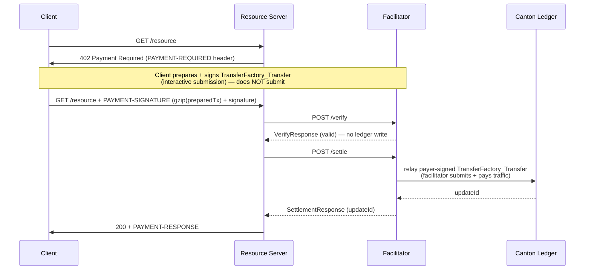

# Exact Payment Scheme for Canton Network (`exact`)

This document specifies the `exact` payment scheme for the x402 protocol on
Canton Network. The client signs a `TransferFactory_Transfer` (CIP-56 Token
Standard transfer instruction) naming the merchant as receiver, but does **not**
submit it. The client carries the complete signed transaction **inline**
(gzip-compressed) in the payment payload, so **any** facilitator can relay it —
the client is not bound to, and needs no prior relationship with, a specific
facilitator. The facilitator relays the payer-signed transaction and pays the
network traffic fee. Because the merchant holds a standing `TransferPreapproval`,
the transfer resolves directly — moving Canton Coin, or any CIP-56 registry
token, to the merchant in a single facilitator-submitted transaction. No escrow,
no lock step, no facilitator custody.

## Scheme Name

`exact`

## Networks

| Network | Identifier |
|---|---|
| Canton MainNet | `canton:mainnet` |
| Canton TestNet | `canton:testnet` |
| Canton DevNet | `canton:devnet` |

## Protocol Flow

One transaction settles each payment:

- **Client (off-ledger):** signs a `TransferFactory_Transfer` — `sender = payer`,
  `receiver = merchant`, `amount`, the specific `inputHoldingCids` spent, and an
  `executeBefore` deadline — as an interactive submission. The client does not
  submit it to the ledger; it carries the complete signed submission — the
  prepared transaction (with its disclosed contracts embedded) plus the payer's
  signature — **inline and gzip-compressed** in the payment payload. The prepared
  transaction is self-contained, so any facilitator can relay it without prior
  state about this payer or payment.
- **Facilitator (on-ledger):** relays (submits) the payer-signed transaction and
  pays the traffic fee. Because the merchant holds a live `TransferPreapproval`,
  the transfer resolves `direct` and pays the merchant in one transaction. The
  facilitator signs nothing on the payer's behalf.



The diagram shows the default `authorization` flow. The scheme also supports the
`upfront` flow (`extra.paymentFlow: "upfront"`), where the resource server calls
`/settle` before running the handler and does not call `/verify`; the facilitator
applies every verification rule at settlement either way.

### Facilitator Independence

A server selects its facilitator opaquely to the client, and there may be many
facilitators. Because the signed submission travels **inline** in the payload and
is self-contained, any facilitator can relay it: the relaying participant submits
the payer-signed transaction on the payer's behalf (it neither hosts the payer
nor signs for it) and pays the traffic fee. There is no requirement that the
client be hosted on, or have any relationship with, the facilitator's
participant.

## Merchant Onboarding

Before receiving payments, the merchant MUST hold a live `TransferPreapproval`
for the payment instrument (Canton Coin or the registry token), with the merchant
as receiver. The preapproval is
what lets an incoming `TransferFactory_Transfer` resolve **direct** — accepted
automatically and settled in a single transaction. Without it, the transfer
resolves to a two-step `TransferInstruction` that the merchant must accept in a
second transaction, so the facilitator cannot settle in one round-trip and MUST
reject the payment (see Verification Rule 7).

A `TransferPreapproval` is time-bounded. The merchant creates it once and reuses it
for all payers, and MUST renew it before expiry to keep the one-transaction path
available:

- **Canton Coin:** a `Splice.AmuletRules:TransferPreapproval` signed by the DSO,
  the merchant (receiver) and a provider, created with
  `AmuletRules_CreateTransferPreapproval` and renewed with
  `TransferPreapproval_Renew`. The merchant may be its own provider, or use its
  validator.
- **CIP-56 registry token:** the receiver's preapproval for that registrar,
  created with the token's registry (for the DA Registry Utility,
  `Utility.Registry.App.V0.Model.TransferPreapproval`, signed by the receiver).

## `PaymentRequirements` for `exact`

```json
{
  "scheme": "exact",
  "network": "canton:mainnet",
  "amount": "1000000000",
  "asset": "CC",
  "payTo": "merchant_party::1220abc...",
  "maxTimeoutSeconds": 60,
  "extra": {
    "assetTransferMethod": "transfer-factory",
    "feePayer": "ftp_facilitator::1220def...",
    "synchronizerId": "global-domain::1220xyz...",
    "instrumentId": { "admin": "DSO::1220...", "id": "Amulet" },
    "executeBeforeSeconds": 120,
    "memo": "invoice-2024-001"
  }
}
```

- `amount`: Integer string of atomic units (1 CC = 1e10 units).
  `"1000000000"` = 0.1 CC. Must match exactly what the ledger records.
- `asset`: `"CC"` for Canton Coin, or the registry token's symbol for a CIP-56
  registry token. The instrument is authoritative via `extra.instrumentId`.
- `payTo`: Merchant's Canton party id `"<name>::<fingerprint>"`.
- `extra.assetTransferMethod`: MUST be `"transfer-factory"`.
- `extra.feePayer`: The facilitator's Canton party id — the party that relays the
  payer-signed transfer and pays its traffic fee. Clients MUST NOT alter this
  value.
- `extra.synchronizerId`: The Global Synchronizer the transfer settles on.
- `extra.instrumentId`: The instrument identifier `{ "admin", "id" }`. For Canton
  Coin, `{ "admin": "<DSO-party>", "id": "Amulet" }`; for a CIP-56 registry token,
  `admin` is the token's registrar party and `id` its instrument id.
- `extra.executeBeforeSeconds`: Relative deadline (seconds from request time) the
  client uses to compute the absolute `executeBefore` timestamp in the transfer;
  after it, the signed transfer is no longer executable.
- `extra.memo` (optional): Seller-defined UTF-8 string, max 256 bytes. When
  present, the client MUST include it in the transfer's metadata.

## `PaymentPayload` `payload` Field

```json
{
  "x402Version": 2,
  "resource": {
    "url": "https://api.example.com/data",
    "description": "Access to protected resource",
    "mimeType": "application/json"
  },
  "accepted": {
    "scheme": "exact",
    "network": "canton:mainnet",
    "amount": "1000000000",
    "asset": "CC",
    "payTo": "merchant_party::1220abc...",
    "maxTimeoutSeconds": 60,
    "extra": {
      "assetTransferMethod": "transfer-factory",
      "feePayer": "ftp_facilitator::1220def...",
      "synchronizerId": "global-domain::1220xyz...",
      "memo": "invoice-2024-001"
    }
  },
  "payload": {
    "assetTransferMethod": "transfer-factory",
    "preparedTransaction": "<base64( gzip( prepared TransferFactory_Transfer, disclosed contracts embedded ) )>",
    "preparedTxHash": "<hex hash of the prepared tx the payer signed>",
    "signature": "<base64 ed25519 sig over preparedTxHash>",
    "hashingSchemeVersion": "HASHING_SCHEME_VERSION_V2"
  }
}
```

- `assetTransferMethod`: `"transfer-factory"`.
- `preparedTransaction`: The complete prepared `TransferFactory_Transfer` (with
  its disclosed contracts embedded), carried inline as base64 of a **single gzip
  member**. It is self-contained: the facilitator relays exactly these bytes and
  resolves nothing on the client's behalf. Encoding and size limits are defined in
  *Payload Encoding & Limits*.
- `preparedTxHash`: The hex hash of the prepared transaction the payer signed. The
  facilitator recomputes it from the decoded prepared transaction and MUST match
  this.
- `signature`: The payer's `ed25519` signature (base64) over `preparedTxHash`. The
  facilitator wraps it into the ledger's `partySignatures` for the payer party and
  derives the payer from the decoded prepared transaction's sender (Rule 8).
- `hashingSchemeVersion`: The Canton hashing scheme used to compute the signed hash.
  `HASHING_SCHEME_VERSION_V2` when absent. A facilitator rejects a hashing scheme
  it does not implement with `invalid_exact_canton_malformed_payload`.

## Payload Encoding & Limits

`payload.preparedTransaction` is the prepared transaction encoded as
`base64( gzip( bytes ) )`. Facilitators MUST enforce all of the following when
decoding it, and reject a payload that violates any of them with
`invalid_exact_canton_malformed_payload`:

- **Single gzip member.** The input MUST be exactly one gzip member: reject
  trailing bytes after the member and concatenated members, and reject the
  optional filename / comment / extra header fields.
- **Bounded decompression.** Decompress incrementally and abort as soon as either
  bound is exceeded: a compressed-size cap (RECOMMENDED ~8 KiB of gzip data) and a
  decompressed-size cap (RECOMMENDED ~64 KiB). Never allocate the output up front
  from a declared size.
- **Bounded decode.** After decompression, cap the work spent decoding the
  transaction: bound structural nesting depth, total node count, and parse time,
  and stop immediately at the first breach.

These bounds make the inline payload safe to accept from an untrusted client
(decompression-bomb, resource-exhaustion, and ambiguous-input resistance).

### Header size

HTTP servers and intermediaries supporting this scheme SHOULD accept a
`PAYMENT-SIGNATURE` header of at least 16 KiB end to end. This provides headroom
for the full payload and extension metadata: `base64(gzip(preparedTransaction))`
alone is typically 6–7 KiB, and encoding the complete `PaymentPayload` commonly
produces a header exceeding 8 KiB. Deployments that cannot accept a 16 KiB
`PAYMENT-SIGNATURE` header SHOULD use a transport, such as MCP, that does not
carry the `PaymentPayload` in an HTTP header.

## `SettlementResponse`

```json
{
  "success": true,
  "payer": "agent_party::1220...",
  "transaction": "122038abc...",
  "network": "canton:mainnet"
}
```

`transaction` is the Canton ledger `updateId` of the relayed
`TransferFactory_Transfer` execution — the single settlement transaction.
Resolvable in any SV Scan API as proof of settlement.

When the outcome is not yet known (see *Settlement*), the facilitator answers
`errorReason: "settlement_pending"` and `transaction` carries the prepared
transaction's hash (`preparedTxHash`, lower-case hex), since no `updateId`
exists before the transaction commits.

On failure:

```json
{
  "success": false,
  "errorReason": "invalid_exact_canton_amount_mismatch",
  "transaction": ""
}
```

## Facilitator Verification Rules (MUST)

1. **Network match.** `paymentPayload.accepted.scheme` and
   `paymentRequirements.scheme` MUST be `exact` (else `unsupported_scheme`), and
   `paymentPayload.accepted.network` MUST equal `paymentRequirements.network`,
   which MUST be a network the facilitator is configured for (else
   `invalid_network`).

2. **Proof present & well-formed.** The payload MUST carry `preparedTransaction`,
   `preparedTxHash` and `signature`. If absent, reject with
   `invalid_exact_canton_missing_proof`. `preparedTransaction` MUST decode within
   the bounds of *Payload Encoding & Limits*; a malformed or over-limit payload
   rejects with `invalid_exact_canton_malformed_payload`.

3. **Signature valid, real factory.** The decoded prepared transaction MUST contain
   exactly one `TransferFactory_Transfer`, its recomputed hash MUST equal
   `preparedTxHash`, and `signature` MUST verify against the payer party over that
   hash. Reject with `invalid_exact_canton_signature_invalid`.

   That exercise MUST target the instrument's real transfer factory. The
   facilitator proves this from the prepared transaction's `input_contracts`,
   which carry every contract the transaction uses but does not create, with its
   template, signatories and arguments. The payer's signature covers them, and
   the confirming participants authenticate each one against its contract id
   when the transaction executes, so a misstated contract makes the transaction
   fail with no funds moved. The exercised contract MUST be an input contract of
   the same template that the payer cannot have created:
   - Canton Coin: `Splice.ExternalPartyAmuletRules:ExternalPartyAmuletRules`
     whose only signatory is `extra.instrumentId.admin` (the DSO);
   - CIP-56 registry token: the receiver's own registry `TransferPreapproval`
     (`Utility.Registry.App.V0.Model.TransferPreapproval`) whose only signatory
     is `payTo`, naming `payTo` as receiver and `extra.instrumentId.admin` as
     instrument admin, for a registrar the facilitator is configured to settle.

   Reject with `invalid_exact_canton_malformed_payload`. Matching a template by
   name alone, or trusting a factory id read from a Scan or registry, is not
   sufficient.

4. **Amount.** The transfer amount MUST equal `paymentRequirements.amount`
   converted to on-ledger Decimal (1 CC = 1e10 atomic units). Reject with
   `invalid_exact_canton_amount_mismatch`.

5. **Receiver.** The transfer receiver MUST equal `paymentRequirements.payTo`.
   Reject with `invalid_exact_canton_merchant_mismatch`.

6. **Instrument.** The transfer instrument MUST match `extra.instrumentId`
   (Canton Coin or the registry token). Reject with
   `invalid_exact_canton_instrument_id_mismatch`.

7. **Preapproval.** The transfer MUST deliver directly to the merchant (`payTo`),
   never through a pending two-step transfer, so the facilitator MUST reject
   **before** relaying and never leave a half-settled state. The facilitator
   proves the delivery path from the signed transaction (see Rule 3 for why its
   input contracts can be trusted):
   - Canton Coin: the transaction exercises `TransferPreapproval_SendV2` on
     exactly one input `Splice.AmuletRules:TransferPreapproval` with
     `receiver = payTo` and `dso = extra.instrumentId.admin`, signed by exactly
     the DSO, the receiver and its provider, whose `validFrom` and `expiresAt`
     enclose the verification time;
   - CIP-56 registry token: the transaction exercises
     `TransferRule_DirectTransfer` on an input `TransferRule` signed by the
     registrar (`extra.instrumentId.admin`).

   Reject with `invalid_exact_canton_preapproval_missing`. The registry
   infrastructure parties that appear in a registry transfer (for the DA
   Registry Utility, its operator and the token's provider) are trusted only
   when the facilitator is configured with them for that registrar.

8. **Proven payer.** The facilitator binds the sender of the signed transfer as
   the proven payer; the client does not supply the payer.

9. **Fee payer.** `extra.feePayer` MUST equal the facilitator's own party — it is
   the relayer that submits the transfer and pays its traffic fee. Reject with
   `invalid_exact_canton_fee_payer_mismatch`.

10. **Deadline.** The transfer's `executeBefore` MUST be at least a small safety
    margin in the future at verification time. Reject with
    `invalid_exact_canton_expired`. A facilitator MAY also cap how far ahead it
    is; reject one beyond the cap with `invalid_exact_canton_execute_before_too_far`.

11. **Self-payment guard.** The proven sender MUST NOT equal the facilitator /
    `feePayer` party. Reject with `invalid_exact_canton_self_payment`.

12. **Memo.** If `paymentRequirements.extra.memo` is set, the transfer metadata
    MUST carry the identical value under `x402.memo`. Reject with
    `invalid_exact_canton_memo_mismatch`.

13. **Input sufficiency.** The transfer's `inputHoldingCids` MUST be non-empty and
    distinct, and each MUST be an input contract of the prepared transaction that
    is a holding of the instrument owned by the proven sender: for Canton Coin a
    `Splice.Amulet:Amulet` signed by exactly the DSO and the sender, for a
    registry token the registry's holding signed by exactly the registrar and the
    sender. A declared input that is not among the input contracts is rejected,
    never skipped. Their amounts MUST sum to at least `amount`; for Canton Coin
    the amount of a holding is its `amount.initialAmount`, since a transfer
    charges no holding fee on its inputs (CIP-0078). Reject with
    `invalid_exact_canton_insufficient_inputs`.

    Whether an input is still unspent is visible only to its stakeholders, so
    verification does not establish it; the ledger enforces it atomically when
    the transaction executes, and a spent input fails the transfer with no funds
    moved. A server that runs its handler after `/verify` (the `authorization`
    flow) therefore accepts a residual risk of wasted handler work, never of
    unpaid delivery, since the response is released only after settlement
    succeeds; the `upfront` flow removes it.

## Merchant Policy

A facilitator pays the traffic for every transfer it relays, so it MAY restrict
the merchants it relays for (for example, to merchants whose preapproval it
provides, or to an allowlist). A payment to any other merchant is rejected with
`invalid_exact_canton_merchant_not_registered`.

## Replay & Duplicate Settlement

The payer-signed transfer names specific input holdings. Once the transfer
executes, those holdings are consumed; resubmitting the same payload references
already-spent holdings, which the ledger rejects. The replay guard is therefore
native and on-ledger — no offchain deduplication store is required for safety.
A participant also deduplicates a resubmitted command id; a facilitator MUST
NOT treat such a duplicate rejection as a failed payment, since the first
submission may have committed.

A facilitator MUST **relay** the signed transfer to settle. It MUST NOT treat a
previously observed `updateId` as settlement: a read of a completed update is
replayable and moves no funds, whereas relaying the signed transfer is
single-use by construction.

## Concurrency & Retry

Because each signed transfer names specific input holdings, concurrent payments
from the same payer contend for those inputs. A payment whose input holding was
consumed by a concurrent settlement fails with
`invalid_exact_canton_execute_failed`; this is transient, and the client SHOULD
retry from scratch — re-preparing and re-signing against fresh inputs. A single
payer's effective settlement parallelism is bounded by the number of distinct
spendable holdings it maintains. There is no shared nonce or sequential counter,
so payments never serialize on a per-payer counter.

## Settlement

The facilitator applies every verification rule, then:

1. **Relay.** Submit the payer-signed `TransferFactory_Transfer` exactly as
   decoded — its execution context (the instrument's config and choice context)
   is already embedded as disclosed contracts, so the facilitator resolves
   nothing further. The facilitator is the sole submitter and pays the traffic
   fee; it signs nothing on the payer's behalf, and the funds move from the
   payer's own holdings.

2. **Success only on commit.** Return `success: true` with the `updateId` once
   the participant reports the transaction committed. The confirming
   participants commit exactly the signed transaction whose effects Rules 3, 7
   and 13 proved, so the commit is the proof that the merchant was paid. A
   definite rejection fails with `invalid_exact_canton_execute_failed`.

3. **Unknown outcome.** If the participant may have accepted the transaction but
   its outcome could not be read (a timeout, a dropped connection, a server
   error, an unreadable completion), the facilitator MUST NOT report failure,
   since the payer could then pay twice. It answers the non-terminal
   `settlement_pending` with `transaction` set to `preparedTxHash`, and
   remembers the submission. On a retry of the same payload it MUST look the
   submission up before relaying again: by its completion, or by the signed
   command id among the payer's transactions recorded since the submission.
   - Found committed: success with its `updateId`.
   - Found rejected: `invalid_exact_canton_execute_failed`.
   - Not found by a participant that hosts the payer (and so sees every
     transaction of the payer), once the transaction can no longer commit:
     `invalid_exact_canton_execute_failed`. A transaction cannot be recorded
     after its ledger-time bound (the signed `max_ledger_effective_time`, which
     the transfer's `executeBefore` sets, or the signed `max_record_time` when
     earlier) plus the synchronizer's ledger-time record-time tolerance.
   - Otherwise: `settlement_pending` again. A facilitator whose participant does
     not host the payer cannot prove absence and never turns a pending
     settlement into a failure. Neither does one whose relay was answered with a
     duplicate-command rejection: an earlier relay of the same transaction was
     accepted and may have committed before the range it searches.

   A facilitator MUST NOT answer a settle from a remembered commit. A pending
   submission resolved as committed is answered with success once and then
   forgotten; any later settle of the same payload relays again, and the
   ledger answers it as a duplicate or a spend of archived inputs.

A failed settlement does not revoke the payer's signature: the signed transfer
stays executable until its `executeBefore`, whoever holds it. Clients SHOULD keep
`executeBefore` short, and facilitators MAY cap it (Rule 10).

## Error Reason Codes

| Code | Meaning |
|---|---|
| `invalid_exact_canton_missing_proof` | Payload does not carry the payer-signed submission. |
| `invalid_exact_canton_malformed_payload` | `preparedTransaction` is not valid base64 / a single gzip member, or exceeds the compressed, decompressed, or decode bounds. |
| `invalid_exact_canton_signature_invalid` | `signature` does not verify against the payer over `preparedTxHash`. |
| `invalid_exact_canton_amount_mismatch` | Transfer amount ≠ `paymentRequirements.amount`. |
| `invalid_exact_canton_merchant_mismatch` | Transfer receiver ≠ `paymentRequirements.payTo`. |
| `invalid_exact_canton_instrument_id_mismatch` | Transfer instrument does not match `extra.instrumentId`. |
| `invalid_exact_canton_preapproval_missing` | The transfer does not deliver directly through the merchant's live `TransferPreapproval` (Canton Coin) or the registrar's direct transfer rule (registry token), so it would not settle in one transaction. |
| `invalid_exact_canton_fee_payer_mismatch` | `extra.feePayer` ≠ the facilitator's own (relaying) party. |
| `invalid_exact_canton_expired` | `executeBefore` is past or within the safety margin. |
| `invalid_exact_canton_execute_before_too_far` | `executeBefore` is further ahead than the facilitator allows. |
| `invalid_exact_canton_insufficient_inputs` | A declared input is not a holding of the instrument owned by the payer and carried in the transaction, or the inputs do not cover `amount` (Rule 13). |
| `invalid_exact_canton_memo_mismatch` | The transfer does not carry `extra.memo` under `x402.memo`. |
| `invalid_exact_canton_merchant_not_registered` | The facilitator does not relay payments to this merchant. |
| `invalid_exact_canton_self_payment` | Proven sender equals the facilitator / `feePayer` party. |
| `invalid_exact_canton_execute_failed` | The relayed transfer was rejected on execution — e.g. an input holding was already spent (concurrent settlement) or funds were insufficient. Transient input contention SHOULD be retried. |
| `unexpected_canton_ledger_error` | Participant read failure, ledger rejection, or timeout not covered above. |
| `settlement_pending` | Non-terminal: the transaction was relayed but its outcome is not known yet; `transaction` carries `preparedTxHash` (see *Settlement*). |
| `invalid_network` | The payload's network differs from the requirements', or the facilitator does not serve it (Rule 1). |
| `unsupported_scheme` | The payload or the requirements do not name the `exact` scheme (Rule 1). |

## References

- [x402 v2 spec](https://github.com/x402-foundation/x402/blob/main/specs/x402-specification-v2.md)
- [SVM scheme spec (precedent)](https://github.com/x402-foundation/x402/blob/main/specs/schemes/exact/scheme_exact_svm.md)
- [CIP-56 Canton Token Standard](https://github.com/canton-foundation/cips/blob/main/cip-0056/cip-0056.md)
- [`splice-api-token-transfer-instruction-v1` (TransferFactory / TransferInstruction)](https://github.com/hyperledger-labs/splice/tree/main/token-standard/splice-api-token-transfer-instruction-v1)
- [Splice Amulet `TransferPreapproval`](https://github.com/hyperledger-labs/splice/tree/main/daml/splice-amulet)
- [CIP-0078: Canton Coin fee removal and holding-fee adjustment](https://github.com/canton-foundation/cips/blob/main/cip-0078/cip-0078.md)
- [Canton network identifiers](https://docs.walletconnect.network/wallet-sdk/chain-support/canton#network-/-chain-information)
