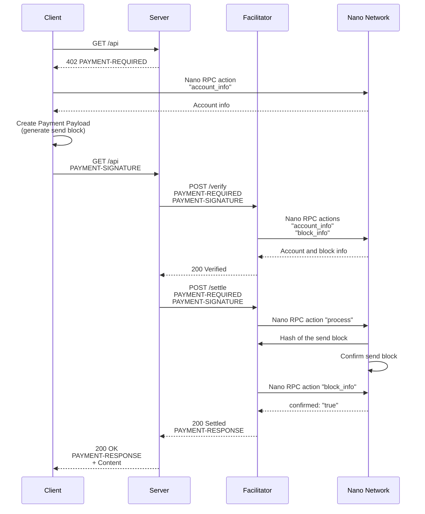

# Scheme: `exact` on `Nano`

## x402 Versions Supported

- ✅ v2

## Supported Networks

- `nano:mainnet` — Nano mainnet (Main network)
- `nano:*` — Any other Nano network

## Summary

The `exact` scheme on Nano uses send blocks for fixed-amount payments. The **`Client`** creates a [send block] based on the **`Resource Server`**'s payment requirement. The **`Facilitator`** verifies and settles this send block on the network. No fee calculation is required as Nano is a feeless network. Settlement typically takes about half a second.

## Protocol Flow

The high-level flow for the `exact` scheme is as follows:

1. **`Client`** sends an HTTP request to the **`Resource Server`** for a resource.
2. **`Resource Server`** responds with a `402 Payment Required` status, including `PaymentRequirements` in a `PAYMENT-REQUIRED` header specifying the `exact` scheme, network, asset `XNO`, account to `payTo`, and `amount` (in [raw units]).
3. **`Client`** constructs and signs a [send block] for the exact amount, and places it inside a `PaymentPayload`. Block construction requires communication with the Nano network to retrieve up-to-date account information.
4. **`Client`** resends the request to **`Resource Server`** with the `PaymentPayload` attached in the `PAYMENT-SIGNATURE` header.
5. **`Resource Server`** forwards the `PaymentPayload` to the **`Facilitator`** for verification (`/verify`).
6. **`Facilitator`** verifies the `PaymentPayload` by querying the Nano network to retrieve up-to-date account and block information.
7. Upon verification, the **`Resource Server`** forwards the `PaymentPayload` to the **`Facilitator`** for settlement (`/settle`).
8. **`Facilitator`** processes the send block contained in the `PaymentPayload` and broadcasts it to the Nano network for confirmation.
9. **`Facilitator`** polls the network for block confirmation.
10. Upon block confirmation (settlement), **`Facilitator`** communicates the send block's hash back to the **`Resource Server`** in the `PAYMENT-RESPONSE` header.
11. **`Resource Server`** delivers the paid resource to the **`Client`** along with `PAYMENT-RESPONSE` header.



## `PaymentRequirements` for `exact`

This payment requirement appears inside the `accepts` array of a `PaymentRequired` object carried in the `PAYMENT-REQUIRED` header.

```json
{
  "scheme": "exact",
  "network": "nano:mainnet",
  "asset": "XNO",
  "amount": "10000000000000000000000000000",
  "payTo": "nano_3ah94brzdm3e5nzzpstzcyxgkddt3ydgzi4478jshawrh7gtof5sb8twxqxt",
  "maxTimeoutSeconds": 120
}
```

- `scheme`: Always `exact` for this scheme.
- `network`: CAIP-2 network identifier, e.g. `nano:mainnet` (Nano mainnet)
- `asset`: This value MUST always be `XNO` as the payment is in native Nano currency. XNO is the ticker for Nano currency.
- `amount`: The amount MUST be expressed in [raw units] (1 nano unit = 10^30 raw units). For example 10000000000000000000000000000 raw units = 0.01 nano units.
- `payTo`: The Nano account that will be receiving the payment. Nano accounts are prefixed with `nano_`.
- `maxTimeoutSeconds`: The maximum number of seconds the **`Facilitator`** SHOULD check for confirmation of the send block on the Nano network.

No additional `extra` fields are required.

## `PaymentPayload` for `exact` (`PAYMENT-SIGNATURE` Header)

**`Client`** includes `PaymentPayload` inside a base64-encoded `PAYMENT-SIGNATURE` header:

```json
{
  "x402Version": 2,
  "resource": {
    "url": "https://example.com/api/data",
    "description": "Access to protected API endpoint",
    "mimeType": "application/json"
  },
  "accepted": {
    "scheme": "exact",
    "network": "nano:mainnet",
    "asset": "XNO",
    "amount": "10000000000000000000000000000",
    "payTo": "nano_3ah94brzdm3e5nzzpstzcyxgkddt3ydgzi4478jshawrh7gtof5sb8twxqxt",
    "maxTimeoutSeconds": 120
  },
  "payload": {
    "block": {
      "type": "state",
      "account": "nano_3qgmh14nwztqw4wmcdzy4xpqeejey68chx6nciczwn9abji7ihhum9qtpmdr",
      "previous": "F47B23107E5F34B2CE06F562B5C435DF72A533251CB414C51B2B62A8F63A00E4",
      "representative": "nano_1hza3f7wiiqa7ig3jczyxj5yo86yegcmqk3criaz838j91sxcckpfhbhhra1",
      "balance": "20000000000000000000000000000",
      "link": "19D3D919475DEED4696B5D13018151D1AF88B2BD3BCFF048B45031C1F36D1858",
      "link_as_account": "nano_3ah94brzdm3e5nzzpstzcyxgkddt3ydgzi4478jshawrh7gtof5sb8twxqxt",
      "signature": "3BFBA64A775550E6D49DF1EB8EEC2136DCD74F....77FFF15FD11E6E2162A1714731B743D1E941FA4560A",
      "work": "ffffffd2e1234567"
    }
  },
  "extensions": {}
}
```

`PaymentPayload.payload` in the `PAYMENT-SIGNATURE` header must follow the following schema:

- `block`: The full contents of the [send block] which authorizes the transfer of [raw units] on the Nano network. During creation of the send block, the **`Client`** MUST use Nano RPC action [account_info] to request the account information it needs to construct the block. Additionally `PaymentPayload.payload.block.work`, the required Proof-of-Work for anti-spam purposes on the Nano network, MUST be generated using `PaymentPayload.payload.block.previous` as input. The `representative` field returned by Nano RPC action [account_info] (call with `representative` parameter set to `true`) SHOULD be used during creation of the send block to avoid re-delegation of the voting weight for the **`Client`**'s Nano account.

## Verification

For the **`Facilitator`** to verify a payment in the `exact` scheme, these checks MUST be carried out in the following order:

1. **x402 Version Check** - `PaymentPayload.x402Version` MUST be equal to any of the **`Facilitator`**'s supported x402 versions.
2. **Scheme Check** - `PaymentPayload.accepted.scheme` and `PaymentRequirements.scheme` MUST have the value `exact`.
3. **Network Supported Check** - `PaymentPayload.accepted.network` and `PaymentRequirements.network` MUST be prefixed with `nano:`.
4. **Network Mismatch Check** - `PaymentPayload.accepted.network` and `PaymentRequirements.network` MUST be equal.
5. **Asset Check** - `PaymentPayload.accepted.asset` and `PaymentRequirements.asset` MUST have the value `XNO`.
6. **Block Structure Check** - `PaymentPayload.payload.block`'s structure MUST match that of a Nano [send block].
7. **Valid Signature Check** - `PaymentPayload.payload.block.signature` MUST be a valid signature for `PaymentPayload.payload.block`.
8. **Valid Block Check** - `PaymentPayload.payload.block` MUST be validated by decoding `PaymentPayload.payload.block.account` into its 32-byte public key, computing the hash of the block (incorporating the `account`, `previous`, `representative`, `balance`, and `link` fields found inside `PaymentPayload.payload.block`), and verifying `PaymentPayload.payload.block.signature` against that hash and public key.
9. **payTo Check** - `PaymentPayload.payload.block.link_as_account` MUST exactly match `PaymentPayload.accepted.payTo`. `PaymentPayload.payload.block.link_as_account` MUST also be the correct Nano account encoding of the 32-byte public key in `PaymentPayload.payload.block.link`.
10. **Previous Confirmation Check** - **`Facilitator`** MUST verify that `PaymentPayload.payload.block` does not already exist on the Nano network. Use Nano RPC action [block_info], passing the calculated hash of `PaymentPayload.payload.block` as a parameter, to check for existence of this block. If [block_info] finds the block, **`Facilitator`** MUST check that the RPC response's `subtype` field is `send` and its `amount` field equals `PaymentPayload.accepted.amount`, returning `error_amount_mismatch` otherwise. If that check passes then **`Facilitator`** MUST return `error_block_already_confirmed` if RPC response field `confirmed` is `true` and `error_block_awaiting_confirmation` if RPC response field `confirmed` is `false`.
11. **Account Check** - `PaymentPayload.payload.block.account` MUST exist on the Nano network. Use Nano RPC action [account_info] to query information for `PaymentPayload.payload.block.account` and ensure that the RPC response has a `frontier` field.
12. **Frontier Hash Check** - `PaymentPayload.payload.block.previous` MUST exactly match frontier hash for `PaymentPayload.payload.block.account`. Use Nano RPC action [account_info] (call with `include_confirmed` parameter set to `true`) to query information for `PaymentPayload.payload.block.account` and check that the `confirmed_frontier` field in the RPC response is equal to `PaymentPayload.payload.block.previous`.
13. **Balance Check** - `PaymentPayload.payload.block.account` MUST have balance to cover payment. Use Nano RPC action [account_info] to query information for `PaymentPayload.payload.block.account` and ensure that the delta between the `balance` field (_previous_balance_) returned in the RPC response and `PaymentPayload.payload.block.balance` (_new_balance_) is equal to `PaymentPayload.accepted.amount` (_payment_amount_). Calculation is _previous_balance_ - _new_balance_ = _payment_amount_.
14. **Work Difficulty Check** - `PaymentPayload.payload.block.work` MUST be validated to ensure it meets the Nano network's current minimum difficulty threshold for a send transaction.

### Valid Verification Response

A valid Verification Response returned by **`Facilitator`** has the following structure:

```json
{
  "isValid": true,
  "payer": "nano_3qgmh14nwztqw4wmcdzy4xpqeejey68chx6nciczwn9abji7ihhum9qtpmdr"
}
```

### Invalid Verification Response

An invalid Verification Response returned by **`Facilitator`** has the following structure:

```json
{
  "isValid": false,
  "invalidReason": "error_not_enough_balance",
  "payer": "nano_3qgmh14nwztqw4wmcdzy4xpqeejey68chx6nciczwn9abji7ihhum9qtpmdr"
}
```

See **Error Vocabulary** later in this document for the full list of `invalidReason` values.

**`Facilitator`** MAY also include an `invalidMessage` field in the invalid Verification Response as free text for humans. **`Client`** and **`Resource Server`** MUST NOT branch on it, `invalidReason` is the contract.

```json
{
  "isValid": false,
  "invalidReason": "error_not_enough_balance",
  "invalidMessage": "Balance for payer's account is not enough to cover payment amount",
  "payer": "nano_3qgmh14nwztqw4wmcdzy4xpqeejey68chx6nciczwn9abji7ihhum9qtpmdr"
}
```

## Settlement

The **`Facilitator`** determines Settlement using a two-step approach:

1. **Broadcast Step** - Before broadcasting, **`Facilitator`** MUST re-verify against the full set of Verification checks. Any check that fails MUST produce an unsuccessful Settlement Response containing the corresponding `errorReason`. If re-verification is successful then **`Facilitator`** broadcasts `PaymentPayload.payload.block` to the Nano network with the Nano RPC action [process] (the `subtype` parameter MUST be set to `send`) and notes the returned hash of the broadcasted block.

2. **Confirmed Step** - **`Facilitator`** polls the network for confirmation of the broadcasted block's hash using Nano node RPC action [block_info]. Check that the field `confirmed` is `true` in the RPC response to determine if the block is confirmed. Polling SHOULD occur at one second intervals, up to a maximum of `PaymentRequirements.maxTimeoutSeconds`.

`Broadcasted` means that **`Facilitator`** has checked the validity of the block and broadcasted the block to the Nano network. The block is not yet confirmed.

`Confirmed` means that the block has successfully gathered enough votes from Nano network representatives to reach quorum and has achieved absolute, irreversible finality.

It is recommended that the **`Facilitator`** SHOULD wait half a second before initial polling for block confirmation using Nano node RPC action [block_info]. A typical Nano block confirms in about half a second so this small wait should reduce the need for additional polling and provides an improved payment experience for the **`Client`**.

It is possible that the **`Client`** adds a block to their Nano account (like an auto-receive block or another concurrent payment) between the Verification and Settlement stages of an ongoing payment attempt. This will result in an unsuccessful Settlement because the **`Client`**'s Nano account now has a different frontier hash to the one that MUST exactly match `PaymentPayload.payload.block.previous` (see **Frontier Hash Check** in Verification). If this happens the **`Facilitator`** MUST return an `errorReason` of `error_previous_not_frontier` (see **Error Vocabulary**) so that the **`Client`** understands that it needs to construct a new [send block] and not attempt to resubmit the now outdated send block.

### Successful Settlement Response

A successful Settlement Response returned by **`Facilitator`** has the following structure:

```json
{
  "success": true,
  "payer": "nano_3qgmh14nwztqw4wmcdzy4xpqeejey68chx6nciczwn9abji7ihhum9qtpmdr",
  "transaction": "0DF7EC8E0955E2A242E3C68B36CBDD639FBB56914AF63AE87295F17D30D9C9D4",
  "network": "nano:mainnet"
}
```

Field Descriptions:

- `payer`: The **`Client`**'s Nano account that signed the send block.
- `transaction`: Hash of the send block.

The **`Resource Server`** base64-encodes the Settlement Response and sends it to **`Client`** in a `PAYMENT-RESPONSE` header:

```json
HTTP/1.1 200 OK
Content-Type: application/json
PAYMENT-RESPONSE: eyJzdWNjZXNzI.....I2NiJ9

{
  "data": "paid resource response data",
  "timestamp": "2026-08-26T10:30:00Z"
}
```

### Unsuccessful Settlement Response

An unsuccessful Settlement Response returned by **`Facilitator`** has the following structure:

```json
{
  "success": false,
  "errorReason": "error_nano_rpc",
  "payer": "nano_3qgmh14nwztqw4wmcdzy4xpqeejey68chx6nciczwn9abji7ihhum9qtpmdr",
  "transaction": "",
  "network": "nano:mainnet"
}
```

If `errorReason` for the unsuccessful Settlement is `error_block_awaiting_confirmation` or `error_block_already_confirmed`, the **`Facilitator`** MUST fill `transaction` in the unsuccessful Settlement Response with the block hash of `PaymentPayload.payload.block` (see **When should Resource Server deliver the resource to Client?** in **Appendix** later in this document).

```json
{
  "success": false,
  "errorReason": "error_block_awaiting_confirmation",
  "payer": "nano_3qgmh14nwztqw4wmcdzy4xpqeejey68chx6nciczwn9abji7ihhum9qtpmdr",
  "transaction": "0DF7EC8E0955E2A242E3C68B36CBDD639FBB56914AF63AE87295F17D30D9C9D4",
  "network": "nano:mainnet"
}
```

```json
{
  "success": false,
  "errorReason": "error_block_already_confirmed",
  "payer": "nano_3qgmh14nwztqw4wmcdzy4xpqeejey68chx6nciczwn9abji7ihhum9qtpmdr",
  "transaction": "0DF7EC8E0955E2A242E3C68B36CBDD639FBB56914AF63AE87295F17D30D9C9D4",
  "network": "nano:mainnet"
}
```

See **Error Vocabulary** in the next section for the full list of `errorReason` values.

**`Facilitator`** MAY also include an `errorMessage` field in the unsuccessful Settlement Response as free text for humans. **`Client`** and **`Resource Server`** MUST NOT branch on it, `errorReason` is the contract.

```json
{
  "success": false,
  "errorReason": "error_invalid_block",
  "errorMessage": "Payer's send block is invalid",
  "payer": "nano_3qgmh14nwztqw4wmcdzy4xpqeejey68chx6nciczwn9abji7ihhum9qtpmdr",
  "transaction": "",
  "network": "nano:mainnet"
}
```

## Error Vocabulary

**`Facilitator`** MUST use the following error codes across both `invalidReason` (Verification failure) and `errorReason` (Settlement failure) to describe errors encountered.

| Error Code                          | Meaning                                                                                                                                                                                                                                                                                | Used In                                                                                           |
| ----------------------------------- | -------------------------------------------------------------------------------------------------------------------------------------------------------------------------------------------------------------------------------------------------------------------------------------- | ------------------------------------------------------------------------------------------------- |
| `error_x402_version_not_supported`  | `PaymentPayload.x402Version` is not supported                                                                                                                                                                                                                                          | x402 Version Check, Unsuccessful Settlement Response                                              |
| `error_unsupported_scheme`          | `PaymentPayload.accepted.scheme` and/or `PaymentRequirements.scheme` do not have the value `exact`                                                                                                                                                                                     | Scheme Check, Unsuccessful Settlement Response                                                    |
| `error_unsupported_network`         | `PaymentPayload.accepted.network` and/or `PaymentRequirements.network` are unsupported                                                                                                                                                                                                 | Network Supported Check, Unsuccessful Settlement Response                                         |
| `error_network_mismatch`            | `PaymentPayload.accepted.network` differs from `PaymentRequirements.network`                                                                                                                                                                                                           | Network Mismatch Check, Unsuccessful Settlement Response                                          |
| `error_invalid_asset`               | `PaymentPayload.accepted.asset` and/or `PaymentRequirements.asset` do not have the value `XNO`                                                                                                                                                                                         | Asset Check, Unsuccessful Settlement Response                                                     |
| `error_invalid_signature`           | `PaymentPayload.payload.block.signature` is not a valid signature for `PaymentPayload.payload.block`                                                                                                                                                                                   | Valid Signature Check, Unsuccessful Settlement Response                                           |
| `error_invalid_block`               | `PaymentPayload.payload.block` is not a valid Nano send block                                                                                                                                                                                                                          | Block Structure Check, Valid Block Check, Unsuccessful Settlement Response                        |
| `error_payto_link_mismatch`         | `PaymentPayload.payload.block.link_as_account` differs from `PaymentPayload.accepted.payTo`                                                                                                                                                                                            | payTo Check, Unsuccessful Settlement Response                                                     |
| `error_account_not_found`           | `PaymentPayload.payload.block.account` not found on the Nano network                                                                                                                                                                                                                   | Account Check, Unsuccessful Settlement Response                                                   |
| `error_previous_not_frontier`       | `PaymentPayload.payload.block.previous` does not match `confirmed_frontier` for `PaymentPayload.payload.block.account`                                                                                                                                                                 | Frontier Hash Check, Unsuccessful Settlement Response                                             |
| `error_not_enough_balance`          | Balance for `PaymentPayload.payload.block.account` is not enough to cover `PaymentPayload.accepted.amount`                                                                                                                                                                             | Balance Check, Unsuccessful Settlement Response                                                   |
| `error_amount_mismatch`             | Delta between the balance for `PaymentPayload.payload.block.account` and `PaymentPayload.payload.block.balance` is not equal to `PaymentPayload.accepted.amount`; or, for a block that [block_info] already finds, its `amount` field is not equal to `PaymentPayload.accepted.amount` | Balance Check, Previous Confirmation Check, Unsuccessful Settlement Response                      |
| `error_invalid_work`                | `PaymentPayload.payload.block.work` is invalid                                                                                                                                                                                                                                         | Work Difficulty Check, Unsuccessful Settlement Response                                           |
| `error_timeout_expired`             | `PaymentRequirements.maxTimeoutSeconds` has expired                                                                                                                                                                                                                                    | Unsuccessful Settlement Response                                                                  |
| `error_block_already_confirmed`     | `PaymentPayload.payload.block` is already confirmed on the Nano network                                                                                                                                                                                                                | Previous Confirmation Check, Unsuccessful Settlement Response                                     |
| `error_block_awaiting_confirmation` | `PaymentPayload.payload.block` has been broadcast to the Nano network and is awaiting confirmation                                                                                                                                                                                     | Previous Confirmation Check, Unsuccessful Settlement Response                                     |
| `error_block_not_broadcast`         | `PaymentPayload.payload.block` unable to be broadcast to the Nano network                                                                                                                                                                                                              | Unsuccessful Settlement Response                                                                  |
| `error_nano_rpc`                    | Nano RPC failure                                                                                                                                                                                                                                                                       | Previous Confirmation Check, Account Check, Frontier Hash Check, Unsuccessful Settlement Response |

## Nano RPC examples

### [account_info] action

Returns information for an account on the Nano network. Specify the Nano account with `account`. Make sure both `include_confirmed` and `representative` are set to `true`.

```
{
  "action": "account_info",
  "account": "nano_3qgmh14nwztqw4wmcdzy4xpqeejey68chx6nciczwn9abji7ihhum9qtpmdr",
  "include_confirmed": "true",
  "representative": "true"
}
```

Used by: **`Client`**, **`Facilitator`**

### [block_info] action

Returns information for a block on the Nano network. Specify the block by passing its block hash into `hash`.

```
{
  "action": "block_info",
  "hash": "1D562FA09DD3D6E99AE41B065861A36930456BE907002BD8F93220DB0FE3995F",
  "json_block": "true"
}
```

Used by: **`Facilitator`**

### [process] action (for a send block)

Broadcasts a [send block] to the Nano network. Make sure that `subtype` is set to `send`, and that `block` has the same structure as `PaymentPayload.payload.block`.

```
{
  "action": "process",
  "block": {
    "type": "state",
    "account": "nano_3qgmh14nwztqw4wmcdzy4xpqeejey68chx6nciczwn9abji7ihhum9qtpmdr",
    "previous": "F47B23107E5F34B2CE06F562B5C435DF72A533251CB414C51B2B62A8F63A00E4",
    "representative": "nano_1hza3f7wiiqa7ig3jczyxj5yo86yegcmqk3criaz838j91sxcckpfhbhhra1",
    "balance": "20000000000000000000000000000",
    "link": "19D3D919475DEED4696B5D13018151D1AF88B2BD3BCFF048B45031C1F36D1858",
    "link_as_account": "nano_3ah94brzdm3e5nzzpstzcyxgkddt3ydgzi4478jshawrh7gtof5sb8twxqxt",
    "signature": "3BFBA64A775550E6D49DF1EB8EEC2136DCD74F....77FFF15FD11E6E2162A1714731B743D1E941FA4560A",
    "work": "ffffffd2e1234567"
  },
  "subtype": "send",
  "json_block": "true"
}
```

Used by: **`Facilitator`**

## Appendix

### Fork protection (recommended practice for **`Resource Server`** and **`Facilitator`**)

**`Resource Server`** SHOULD temporarily store the `PaymentPayload.payload.block.previous` value of any ongoing Verification / Settlement attempt. If any further payment attempt reaches the **`Resource Server`** with the same `PaymentPayload.payload.block.previous` field, the **`Resource Server`** should reject it. Once the ongoing payment attempt is verified and settled, the **`Resource Server`** no longer needs to store the `PaymentPayload.payload.block.previous` value.

This precaution prevents accidental or malicious fork submission. Forks are blocks with the same `previous` value.

If two blocks with the same `previous` value are broadcast to the Nano network, the first block to reach quorum among Nano network representatives will be confirmed onto the Nano network. The other block gets rejected forever.

### Blocks have no expiry

Valid blocks that have been broadcast by the **`Facilitator`** but not yet confirmed do not expire. They exist on the network until confirmed, which typically takes about half a second. `PaymentRequirements.maxTimeoutSeconds` bounds the **`Facilitator`**'s polling period for confirmation of the send block, not expiration. Should `PaymentRequirements.maxTimeoutSeconds` expire, the **`Facilitator`** MUST return `error_timeout_expired` in `errorReason` (see **Error Vocabulary**).

If `PaymentRequirements.maxTimeoutSeconds` expires or if the Settlement status for a [send block] needs to be re-queried, make another Settlement attempt (resettlement) of the `PaymentPayload` containing the send block and read the `errorReason` and `transaction` fields of the Settlement Response.

### When should **`Resource Server`** deliver the resource to **`Client`**?

When a **`Resource Server`** wants to determine whether a resource should be delivered to the **`Client`**, there are three individual **Settlement Response** scenarios of note:

#### Scenario 1

```json
{
  "success": true,
  "transaction": "0DF7EC8E0955E2A242E3C68B36CBDD639FBB56914AF63AE87295F17D30D9C9D4",
  "payer": "nano_3qgmh14nwztqw4wmcdzy4xpqeejey68chx6nciczwn9abji7ihhum9qtpmdr",
  "network": "nano:mainnet"
}
```

- `success` equals `true`

Send block has been broadcast and confirmed on the Nano network. `transaction` contains the send block's hash.

Resource MUST be delivered to **`Client`** and **`Resource Server`** MUST record the send block's hash as served at the moment of delivery because _Scenario 2_ reads that record. If multiple **`Resource Servers`** share the same `payTo` destination, they SHOULD record in a unified database keyed by the send block's hash to ensure delivery tracking is shared across all processes.

_Scenario 1_ can only happen once per send block.

#### Scenario 2

```json
{
  "success": false,
  "errorReason": "error_block_already_confirmed",
  "transaction": "0DF7EC8E0955E2A242E3C68B36CBDD639FBB56914AF63AE87295F17D30D9C9D4",
  "payer": "nano_3qgmh14nwztqw4wmcdzy4xpqeejey68chx6nciczwn9abji7ihhum9qtpmdr",
  "network": "nano:mainnet"
}
```

- `success` equals `false`
- `errorReason` equals `error_block_already_confirmed`

Send block has previously been broadcast and confirmed on the Nano network. `transaction` contains the send block's hash.

This response does not tell the **`Resource Server`** whether the resource was already delivered to the **`Client`**. **`Resource Server`** MUST deliver to **`Client`** only if its own records show that the resource has not yet been delivered to **`Client`**; otherwise this is a replay and the resource MUST NOT be delivered again.

However if resource had not been previously delivered, **`Resource Server`** SHOULD now deliver the resource and record the send block's hash as served at the moment of delivery. If multiple **`Resource Servers`** share the same `payTo` destination, they SHOULD record in a unified database keyed by the send block's hash to ensure delivery tracking is shared across all processes.

#### Scenario 3

```json
{
  "success": false,
  "errorReason": "error_block_awaiting_confirmation",
  "transaction": "0DF7EC8E0955E2A242E3C68B36CBDD639FBB56914AF63AE87295F17D30D9C9D4",
  "payer": "nano_3qgmh14nwztqw4wmcdzy4xpqeejey68chx6nciczwn9abji7ihhum9qtpmdr",
  "network": "nano:mainnet"
}
```

- `success` equals `false`
- `errorReason` equals `error_block_awaiting_confirmation`

Send block has been broadcast but not yet confirmed on the Nano network. `transaction` contains the send block's hash (see **Blocks have no expiry** in **Appendix**).

Resource MUST NOT be delivered to **`Client`**, until a resettlement encounters _Scenario 2_ and the **`Resource Server`**'s own records show that the resource has not yet been delivered to **`Client`**.

If the block is still awaiting confirmation after a bound of the **`Resource Server`**'s choosing, it SHOULD stop resettling and answer 402 again; the **`Client`**'s remedy is a new send block. If the earlier block confirms later, it is a payment to `payTo` and the **`Client`** may present it under _Scenario 2_.

[send block]: https://docs.nano.org/protocol-design/blocks/#state-blocks
[raw units]: https://docs.nano.org/integration-guides/the-basics/#units
[work]: https://docs.nano.org/protocol-design/spam-work-and-prioritization/#work-algorithm-details
[account_info]: https://docs.nano.org/commands/rpc-protocol/#account_info
[block_info]: https://docs.nano.org/commands/rpc-protocol/#block_info
[process]: https://docs.nano.org/commands/rpc-protocol/#process
